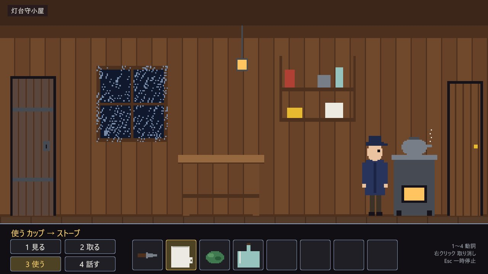
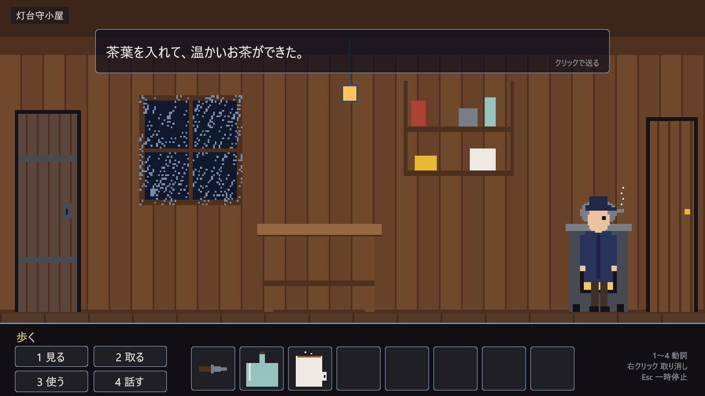
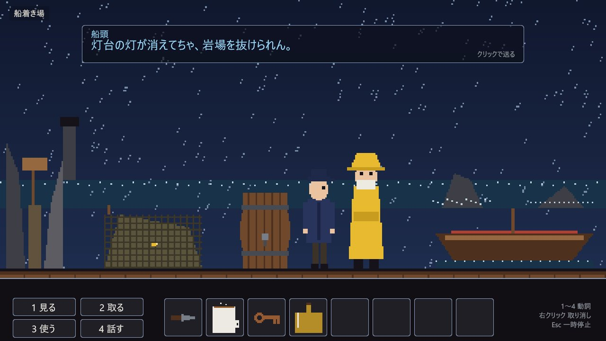
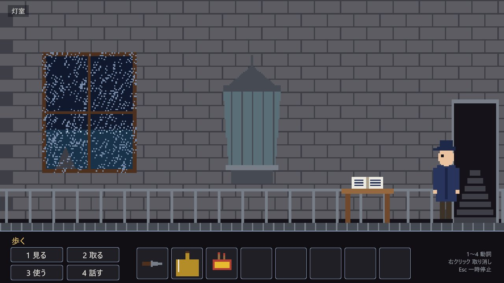
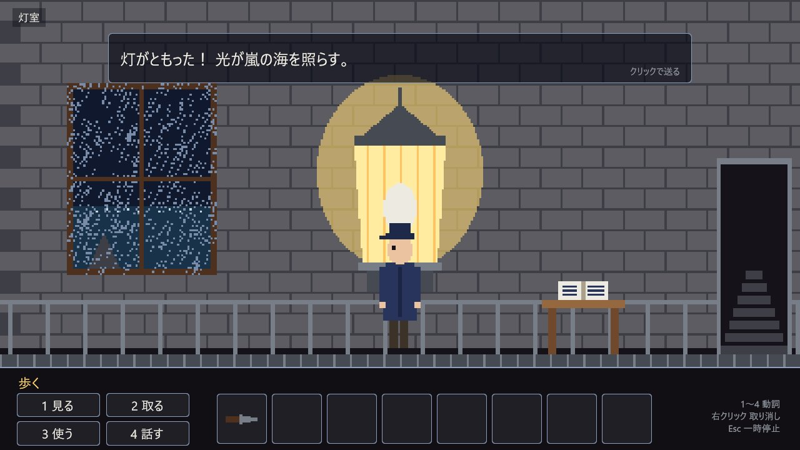
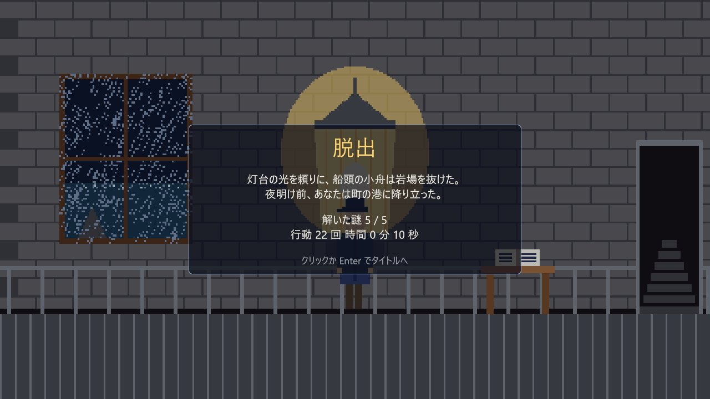

# 047 検証記録

セッション 3 の撮影（Windows ビルド、`dev capture 047`）。自動検証の結果と撮影の再現はセッション 4 で記録する。

## 画面

| タイトル | 操作説明 | 動詞と命令文 |
|---|---|---|
|  |  |  |

| 包丁を拾う | 持ち物を使う命令文 | 持ち物の組み合わせ |
|---|---|---|
|  |  |  |

| 船着き場 | 会話の話題 | 船頭の返事 |
|---|---|---|
|  |  |  |

| 灯台への扉が開く | 灯室 | 灯がともる |
|---|---|---|
|  |  |  |

| 結果 |
|---|
|  |

撮影記録：[current.json](current.json)
