# 048 検証記録

2026-11-27 実施（セッション 4）。

## 自動検証

| 項目 | 結果 |
|---|---|
| dev lint | 成功 |
| dev check | 成功（警告 0） |
| dev test | 成功。Core 58/58、App 26/26 |
| Unity EditMode | 160/160（パッケージ int-geometry 60・tile-motion 10・Core 58・App 26・Editor 6。Mono） |
| Unity PlayMode | 26/26（実シーン 10、共通の証跡公開 16） |
| Windows ビルド | 成功、StandaloneWindows64。ビルドの前の検証フックが本番の部屋の定義・状態空間の探索・Stage Prefab の照合を通過 |
| 壊した部屋のビルド | 引き出しの真鍮の鍵の入れ物をダイヤル錠からキャビネット（その鍵で開く）に変えて `dev build 048` を流すと、`BuildFailedException: 部屋 天文学者の書斎 の探索で誤りが見つかりました` と `どの手順でも脱出に到達しません` でビルドが止まることを確かめてから戻した |
| ビルド起動 | dev capture で起動・全場面撮影・正常終了 |
| 証跡 | JPEG 品質 85、17 枚、1280×720 |
| 撮影再現 | 同一ビルド `bf3efe66391b4aaf8dca21224ea5c19d` の 2 回の撮影（撮影 ID `20261127T035727Z-ae4cee23` と `20261127T035742Z-530396e6`）が同じ画像世代 `dd94617dfb278d1f` になり、17 枚の SHA-256 が一致した。壊した部屋のビルドを確かめて戻した後のビルド（同じ Build GUID）の撮影（`20261127T035837Z-860cd382`）も同じ画像世代だった（[最新の記録](current.json)）。前の記録は公開の整理で消える |
| 固定ハッシュ | 部屋の定義の指紋 `078C043D`。シード 1 の次の一手の通しの最終ハッシュ（Core `44E972DE`、操縦役が Flow を通して `8B6DBBC1`）が .NET と Mono で一致。撮影の最終状態は `1C426C57`（台本の操作とヒントが加わるので別の値。同一ビルドの 2 回で一致） |
| 題材固有テスト | 未解除ロックを操作で迂回できない（状態空間の全 15 状態で迂回なし＋個別の負例：鍵なしの鍵穴・ハンドルなしの宝石・歯車なしの針・円盤なしのリング・閉じた引き出しの鍵は前板に当たる・鍵なし／違う鍵の出口。いずれも拒否で状態・ハッシュ不変）／ヒント表示と実状態が一致（全到達状態で、案内する仕掛けが操作できる・案内する操作を受け付ける・答えの段階のとおりに操作すると一手進む・解いた物を案内しない、シードで答えの文が変わる、通しで連鎖の順に案内する）／同時操作で状態破綻なし（同じフレームの 2 部品・向き直り＋クリック・ヒント＋クリック・リセット＋クリック・ダブルクリック・使う＋2 回目、乱択の 6,000 命令で持ち物の重複なし・Solved が戻らない・出口は全てを解いた後だけ） |
| カメラとヒットテスト | スラブ法を面ごとの交差の参照実装と乱択 20,000 組で照合。全ての到達状態・全ての視点で画面を刻み、当たる部品が触れられる物だけ（遮りが効く）・壁の視点の当たりはその壁の近景へ寄る。実シーンで、全ての視点・今ある全ての部品の手前の面の中心について、Core のヒットテストと `Physics.Raycast`（照合専用の BoxCollider）が同じ部品に当たる（遊び始めと脱出の後） |
| 完了判定 | 5 つの仕掛けを解いて脱出（Core・App で 8 シード・実シーンで仮想マウスとキーボードの入力だけ・撮影）／リセットで初期状態へ（Core・App のハッシュ一致、実シーンの表示が遊び始めと同じ、タイトルへ戻った表示が起動直後と同じ） |

撮影の台本は、撮影のシード（1）から作った試合で、操縦役（ヒントと同じ次の一手）と遊ぶときと同じ入力（向き直りのキー・画面の点のクリック・持ち物の枠・ドラッグ）を Tick ずつ進める。

## 画面

| タイトル | 操作説明 | 北の壁 |
|---|---|---|
| 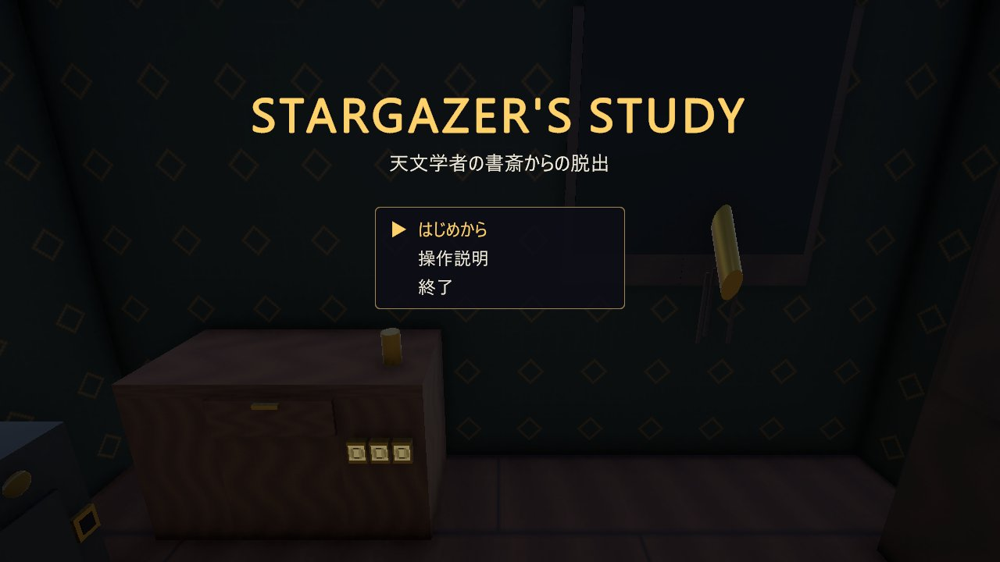 | 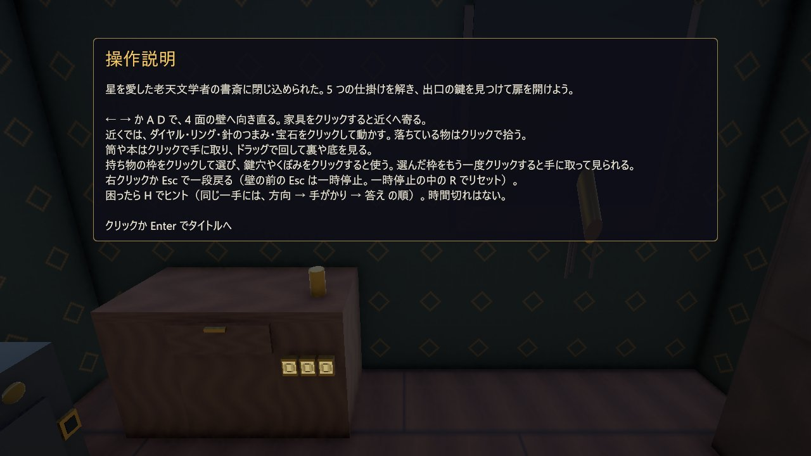 | 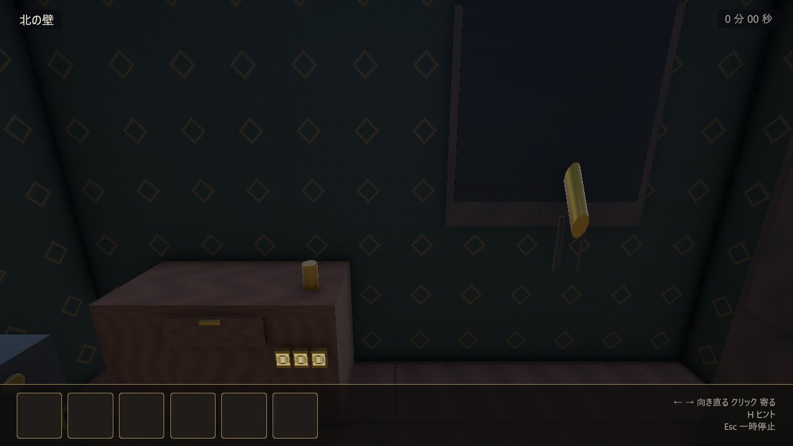 |

| 机の近景 | 真鍮の筒の底（手がかり） | 引き出しが開く |
|---|---|---|
| 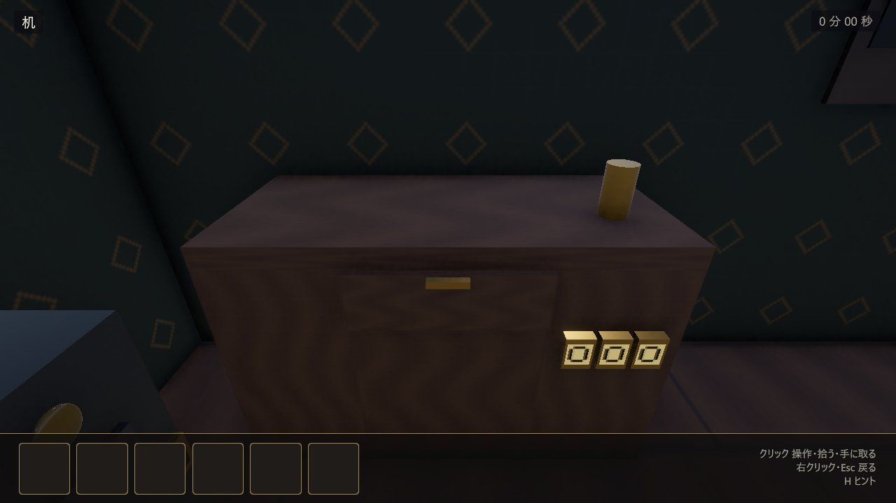 | 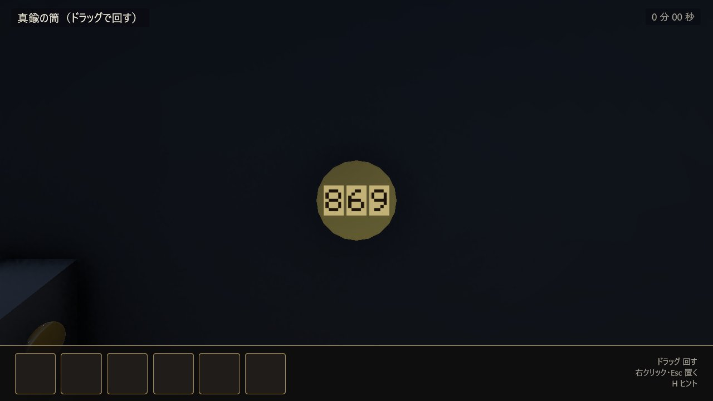 | 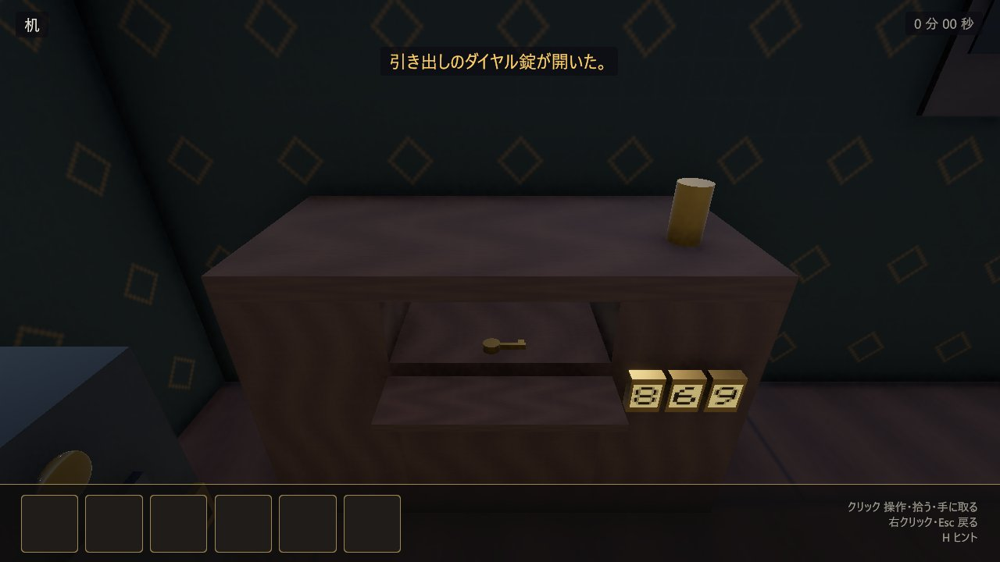 |

| キャビネットが開く | 星図の円盤の裏（手がかり） | 天球儀のリング |
|---|---|---|
| 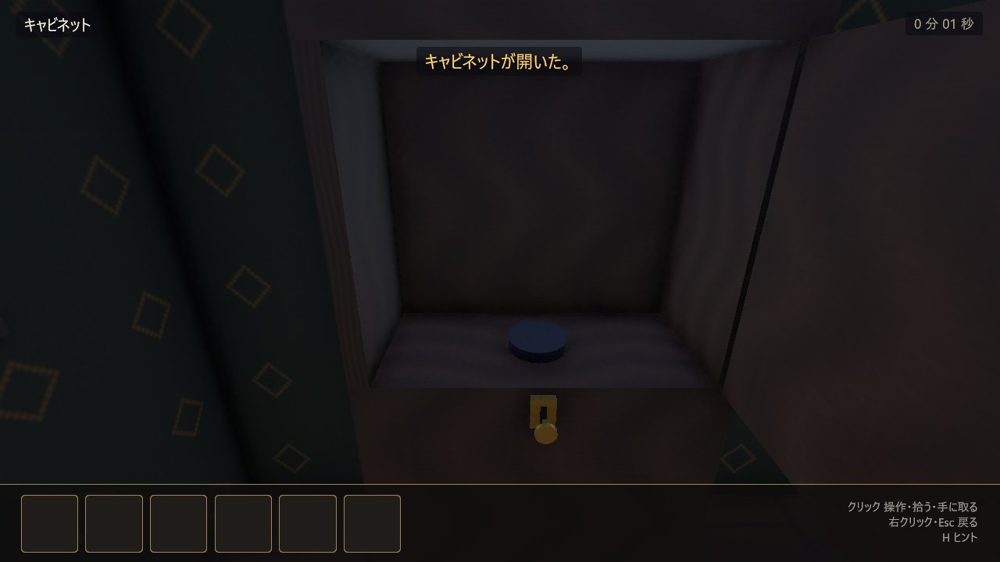 | 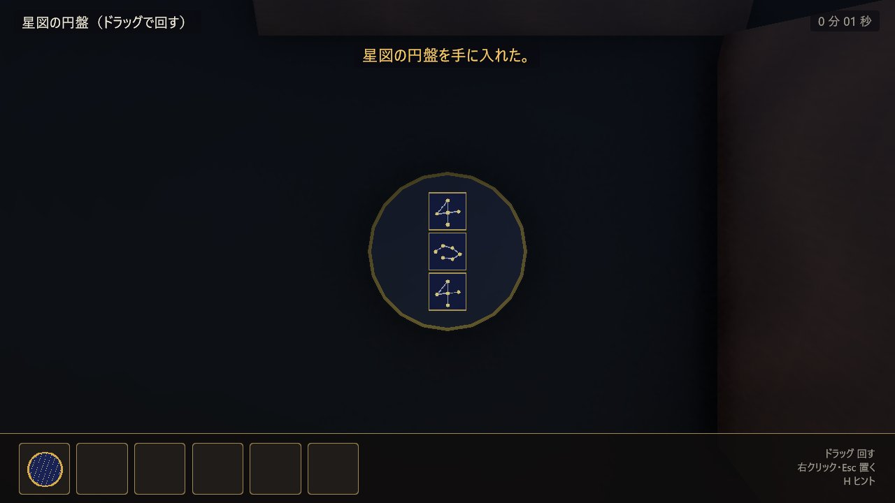 | 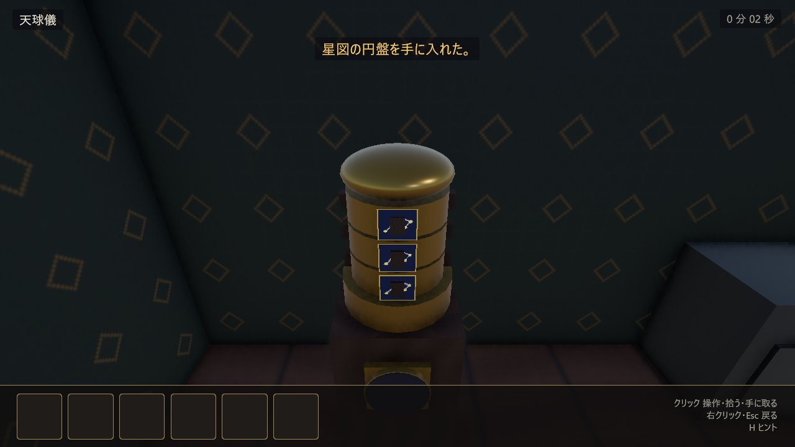 |

| 天球儀が開く | 天文書の裏表紙（手がかり） | 柱時計が開く |
|---|---|---|
| 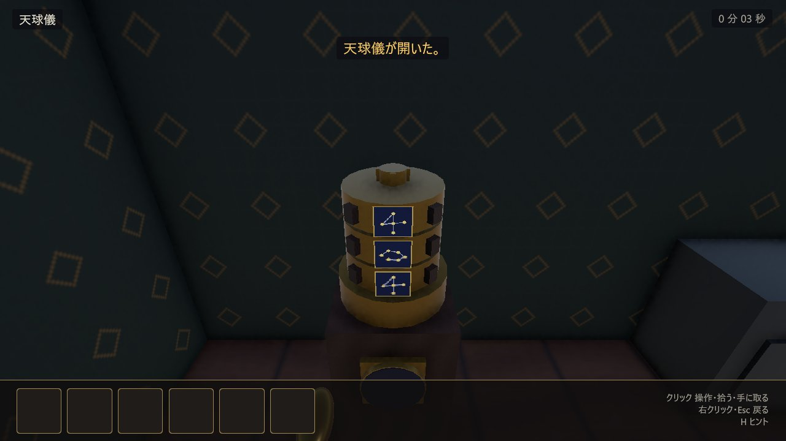 | 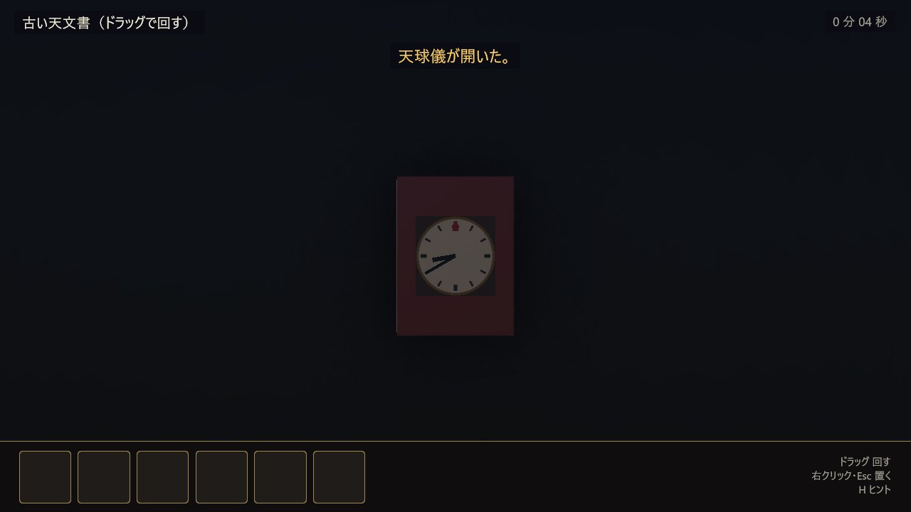 | 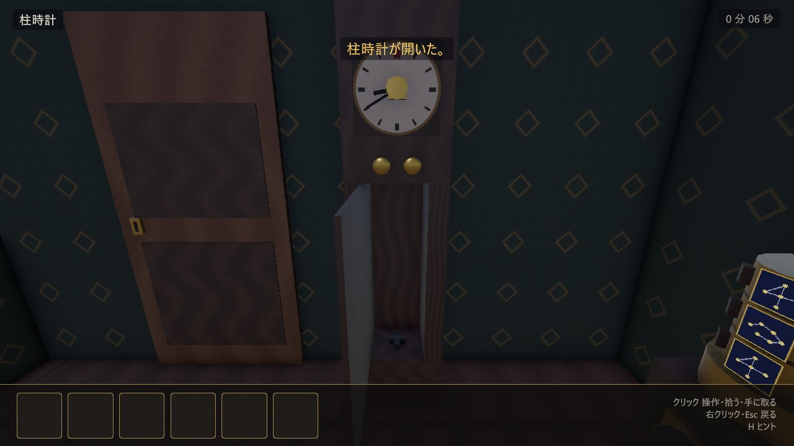 |

| 望遠鏡の星（手がかり） | 金庫の宝石 | ヒント（答えの段階） |
|---|---|---|
| 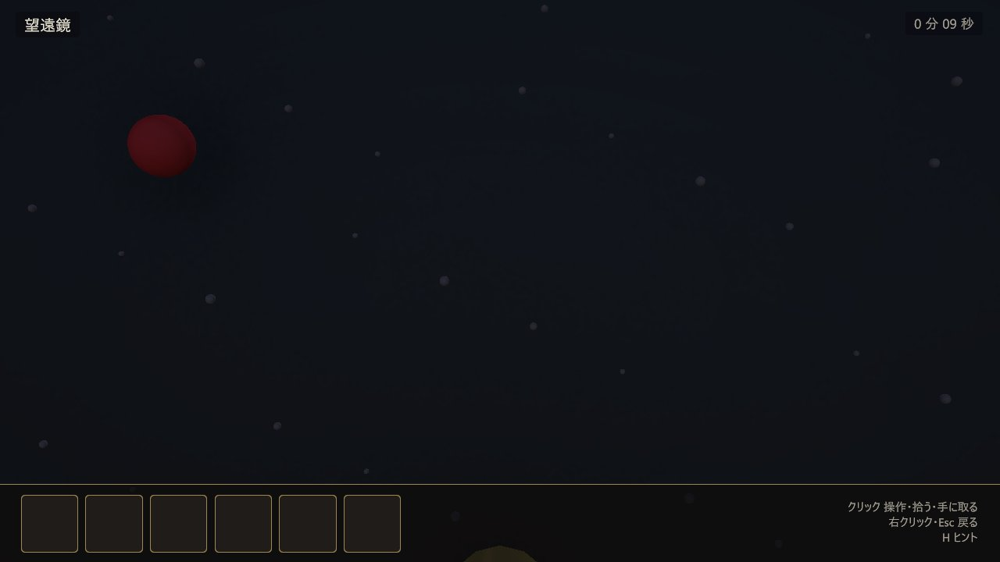 | 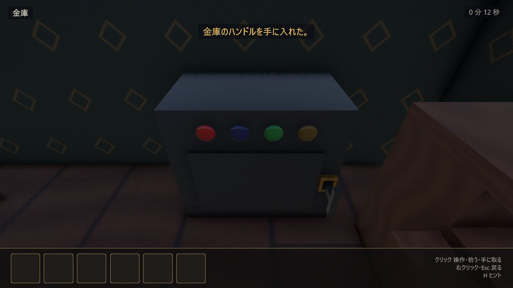 | 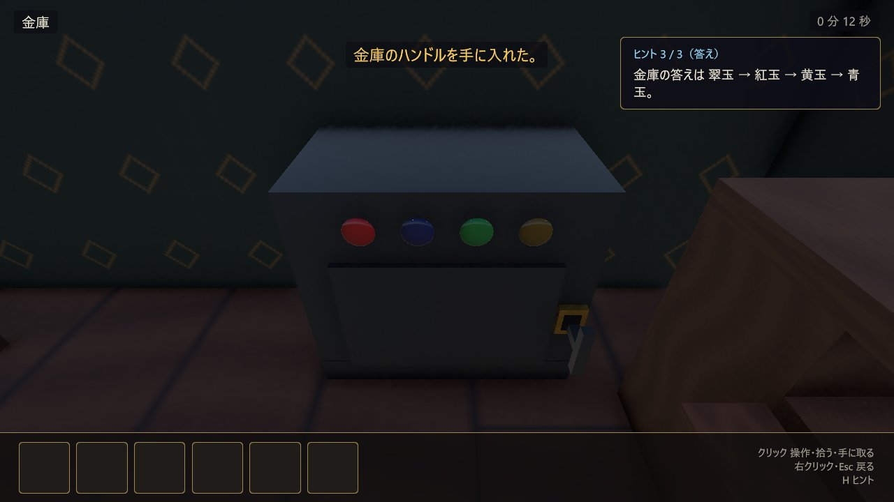 |

| 脱出 | 結果 |
|---|---|
| 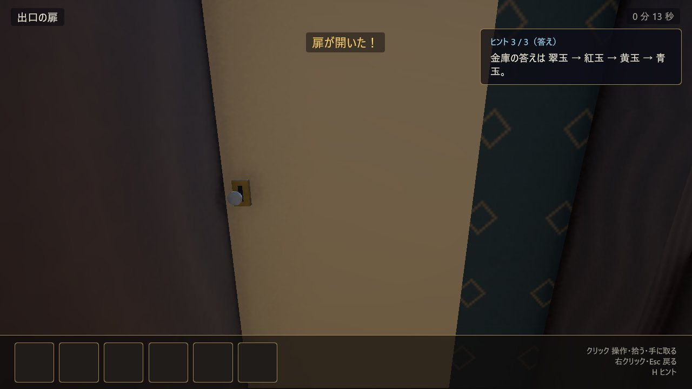 | 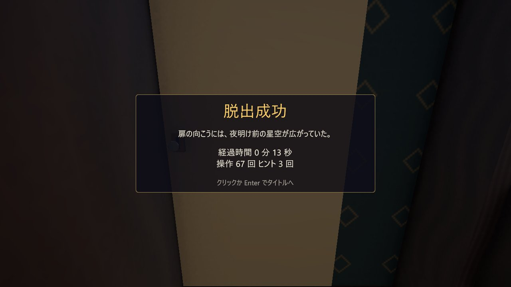 |

撮影記録：[current.json](current.json)
