# 048 検証記録

2026-11-27 実施（セッション 4）。同日、試遊の指摘（画面が暗い）とコードレビュー（P1-1・P2-1〜P2-4・P3-1）に対応し、さらに試遊 2 回目の指摘（本棚が壁に見える・天球儀の台座のくぼみが HUD の帯に重なる・天球儀から先へ進めない）に対応してから、テストを流し直して撮り直した。

## 自動検証

| 項目 | 結果 |
|---|---|
| dev lint | 成功 |
| dev check | 成功（警告 0） |
| dev test | 成功。Core 67/67、App 35/35 |
| Unity EditMode | 179/179（パッケージ int-geometry 60・tile-motion 10・Core 67・App 35・Editor 7。Mono） |
| Unity PlayMode | 33/33（実シーン 17、共通の証跡公開 16） |
| Windows ビルド | 成功、StandaloneWindows64。ビルドの前の検証フックが本番の部屋の定義・クリックできるかを含む状態空間の探索・Stage Prefab の照合を通過 |
| 壊した部屋のビルド | 論理の詰み：引き出しの真鍮の鍵の入れ物をキャビネット（その鍵で開く）に変えると `どの手順でも脱出に到達しません` で止まる（レビュー対応前に確認）。幾何の詰み：金庫の 4 つの宝石の手前に、いつもある覆いの箱（`safe.cover`）を足すと `クリックできない：safe:operate safe.gem0 は受け付けるのに、画面の範囲 ±1600・y≥-700 にその命令になる点がありません（到達の手順）` と `どの手順でも脱出に到達しません` で止まる（レビュー対応後に確認）。どちらも確かめてから戻した |
| ビルド起動 | dev capture で起動・全場面撮影・正常終了 |
| 証跡 | JPEG 品質 85、18 枚（本棚の近景を足した）、1280×720 |
| 撮影再現 | 同一ビルド `cf9e29b9ba3d448393f17272fa047080` の 2 回の撮影（撮影 ID `20261127T123803Z-26c7bd44` と `20261127T123820Z-6df4394a`）が同じ画像世代 `424dbc504fd68d52` になり、18 枚の SHA-256 が一致した（[最新の記録](current.json)）。明るさ・本棚・天球儀の視点・ヒントの文・扉の向こうの空を変えたので、前の画像世代とは画像が違う。前の記録は公開の整理で消える |
| 固定ハッシュ | 部屋の定義の指紋 `EE95CC2A`。シード 1 の次の一手の通しの最終ハッシュ（Core `9EB22E21`、操縦役が Flow を通して `8503582E`）が .NET と Mono で一致。撮影の最終状態は `49EEA0B4`（同一ビルドの 2 回で一致）。レビュー対応では変わらなかった（Core `44E972DE`・操縦役 `8B6DBBC1`・撮影 `1C426C57`）が、試遊 2 回目の対応で部屋の定義（手がかりの上の向き・本棚の箱・天球儀の視点）が変わり、指紋を混ぜるハッシュが変わった |
| 状態空間 | 15 状態・63 遷移（レビュー対応・試遊の対応の前後で同じ。本番の書斎では、論理的に受け付ける手は全て決めた画面の範囲でクリックできたので、除かれる手がない） |
| 計測 | 状態空間の探索（クリックできるかの探索を含む）：Mono 30.9 ms（テストの中で JIT の後の 1 回。この PC の Stopwatch。本棚の部品を足して 12.5 ms から増えた）。ビルド前の検証全体（部屋の定義・探索・Prefab の照合）：Mono 42.7 ms |
| 題材固有テスト | 未解除ロックを操作で迂回できない（状態空間の全 15 状態で迂回なし＋個別の負例：鍵なしの鍵穴・ハンドルなしの宝石・歯車なしの針・円盤なしのリング・閉じた引き出しの鍵は前板に当たる・鍵なし／違う鍵の出口。いずれも拒否で状態・ハッシュ不変）／ヒント表示と実状態が一致（全到達状態で、案内する仕掛けが操作できる・案内する操作を受け付ける・答えの段階のとおりに操作すると一手進む・解いた物を案内しない、シードで答えの文が変わる、通しで連鎖の順に案内する）／同時操作で状態破綻なし（同じフレームの 2 部品・向き直り＋クリック・ヒント＋クリック・リセット＋クリック・ダブルクリック・使う＋2 回目、乱択の 6,000 命令で持ち物の重複なし・Solved が戻らない・出口は全てを解いた後だけ） |
| カメラとヒットテスト | スラブ法を面ごとの交差の参照実装と乱択 20,000 組で照合。全ての到達状態・全ての視点で画面を刻み、当たる部品が触れられる物だけ（遮りが効く）・壁の視点の当たりはその壁の近景へ寄る。実シーンで、全ての視点・今ある全ての部品の手前の面の中心について、Core のヒットテストと `Physics.Raycast`（照合専用の BoxCollider）が同じ部品に当たる（遊び始めと脱出の後） |
| 完了判定 | 5 つの仕掛けを解いて脱出（Core・App で 8 シード・持ち物を選んだ途中の状態から・実シーンで仮想マウスとキーボードの入力だけ・撮影）／リセットで初期状態へ（Core・App のハッシュ一致、実シーンの表示が遊び始めと同じ、タイトルへ戻った表示が起動直後と同じ） |

## 試遊 2 回目の対応

| 指摘 | 原因と対応 |
|---|---|
| 天球儀から先へ進めない | 詰みではなく読み違い。円盤を縦に 2 回ドラッグ（x 軸まわりに 180°）しても「手がかりがこちらを向いた」と判定していたため、星座が上下逆さに、上・中・下の並びも逆に見えた。手がかりは**正立しているときだけ**読めるようにした（`Orientation.ShowsUpright`、手に取る物ごとに手がかりの上の向き `ClueUp` を宣言）。あわせてリングの答えの段階のヒントに「今の位置から上のリングをあと N 回…」を、宝石に色を添えた。回帰テスト `GeometryTests.Orientation_ClueIsReadableOnlyUpright`・`WorldTests.Inspect_UpsideDownClue_IsNotReadable`・`Hint_RingAnswer_TellsClicksFromCurrentPosition`。攻略は [walkthrough.md](../walkthrough.md) |
| 本棚が壁に見え、本が壁に刺さって見える | 本棚を 1 つの箱から、背板・側板・天板・4 段の棚板で囲んだ棚に作り直し、本は棚板の上に置いた（天文書だけが前へ飛び出す） |
| 天球儀の台座のくぼみが HUD の帯に重なる | 天球儀の近景の目を 200 mm 下げ、くぼみが帯より上に写るようにした |
| 脱出の後、「星空が広がっていた」のに扉の向こうが黄色い壁に見える（試遊 3 回目） | 扉の向こうの板を、上は星の残る紺・下は地平線の橙の夜明け前の空（光の影響を受けない生成テクスチャ）にした |

## レビュー対応

| 指摘 | 対応 | 修正前のコードで失敗を確認したテスト |
|---|---|---|
| P1-1 論理的に受け付ける手と、画面でクリックできる手の食い違い | 状態空間の探索が、近景へ寄る命令とクリックで出す命令（拾う・使う・手に取る・操作・答えまで動かす手の各段）ごとに、決めた画面の範囲でその命令になる点を `ClickSearch` で探し、見つからなければ手から除いて「クリックできない」を誤りにする（fail-closed）。点の探し方は、部品の手前の面の 5 × 5 の点の後に範囲を 20 刻みで走査する十分条件で、完全な可視領域の判定ではない | `StateSpaceTests.Explore_RejectsGeometricallyUnclickableRooms`（必須の鍵を箱が完全に遮る・近景の入口を衝立が遮る・画面の横の外・HUD の帯の下）。正常系 `Explore_AcceptsPartThatBecomesClickableWhenPlateOpens`（前板が倒れると触れる）。ビルド前の検証 `EditorChecksTests.GeometricallyUnclickableRoomStopsTheBuild` |
| P2-1 操縦役が、実行されなかった命令を成功にする | Flow が命令を実行するたびに通し番号（`Executed`）と命令（`LastCommand`）を記録し、操縦役と PlayMode の入力は「ちょうど 1 つ実行された・狙った命令だった・受け付けられた」を確かめる（`Autopilot.Verify`） | `FlowTests.Perform_Throws_WhenInputIsDroppedByFocusLoss`・`Perform_Throws_WhenClickIsDroppedDuringCameraMove`・`Verify_Throws_WhenAnotherCommandWasExecuted` |
| P2-2 持ち物を選んだまま操縦役を始めると食い違う | 操縦役は命令の前に選択を合わせる（使う命令なら目的の持ち物を選び、ほかは外す）。選択の操作の後に状態を確かめる | `FlowTests.Perform_DeselectsBeforeBack_SoBackReallyLeavesTheCloseUp`。`Autopilot_FromMidGameWithItemSelected_Escapes` は、修正前のコードでも計画の作り直しで結局脱出するので通る（偽の成功は上の P2-1 のテストで検出する） |
| P2-3 クリックの探索と画面の比率の食い違い | 対応する画面の比率を 16:10〜21:9 と決め、Unity はこれより狭い・広い画面に黒い帯を付けて描画の矩形を収める。部屋のクリックが届く範囲（`ScreenRegion`：横は描画の矩形の比率、下は HUD の帯の上）を Flow に渡し、範囲の外のクリックは部屋に通さない。検証と操縦役は、対応する全ての画面で届く範囲（±1600・y≥-700）だけを使う。16:9 固定にしなかったのは、AGENTS.md の方針（横長の範囲 16:10〜21:9 でプレイ領域が切れない）と合わせるため | `FlowTests.ClickOutsideRegion_IsNotPassedToTheRoom`、`EscapeSceneTests.ViewportKeepsSupportedAspect_AndRegionCoversGuaranteed` |
| P2-4 ドラッグの残りと寿命 | ドラッグに始めた画面の版を持たせ、手に取った物・視点・画面が変わった後の古いドラッグを捨てる。手に取った物・視点・画面が変わったら端数も捨てる。Unity はドラッグを押した版の間だけ続ける | `FlowTests.Drag_StartedBeforePutDown_IsRejected`、`EscapeSceneTests.HeldLeftButtonAcrossPutDown_DoesNotRotateTheNextObject`（右クリック・Esc。フォーカス喪失は修正前から止まっていた）。`Drag_ResidueIsDiscarded_WhenHeldObjectChanges` は、手に取り直すクリックが修正前から端数を消していたので修正前でも通る |
| P3-1 手がかりの表示 | 3 つのシードで、筒の底の 3 桁・円盤の 3 星座のマテリアル、天文書の針の角度、望遠鏡の星が光り始める順を、そのシードの答えと照合する | `EscapeSceneTests.CluesShowTheAnswersOfEachSeed`（筒の底を固定値にすると失敗） |

修正前のコードでの失敗は、修正した箇所だけを一時的に元の振る舞いへ戻して流し、確かめた後に戻した（新しい API を使うテストがあるので、コミット前のファイルへそのまま戻すとテストが組み立てられないため）。

撮影の台本は、撮影のシード（1）から作った試合で、操縦役（ヒントと同じ次の一手）と遊ぶときと同じ入力（向き直りのキー・画面の点のクリック・持ち物の枠・ドラッグ）を Tick ずつ進める。

## 画面

| タイトル | 操作説明 | 北の壁 |
|---|---|---|
| 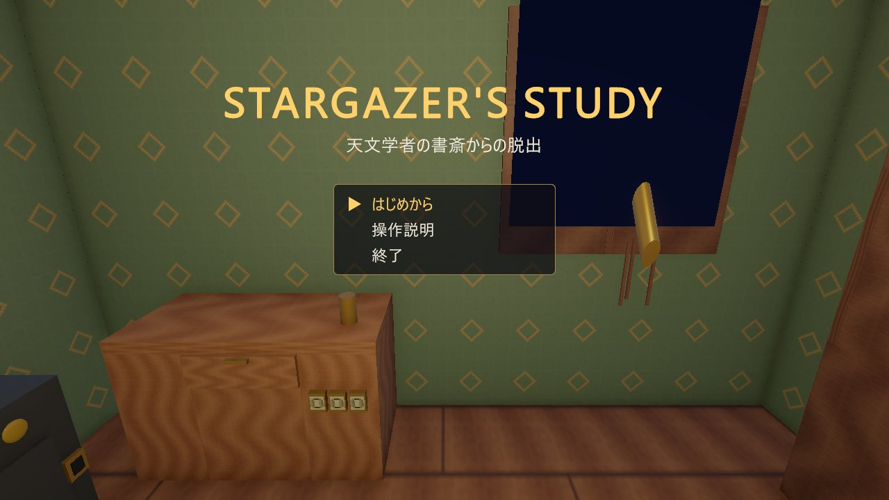 | 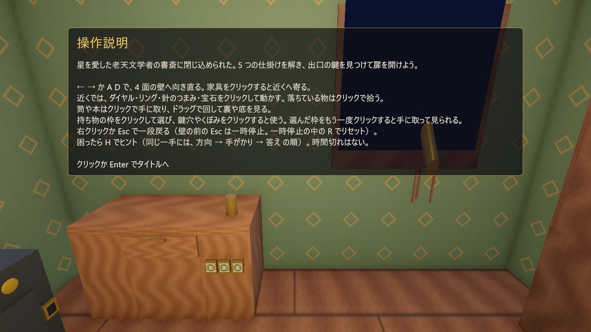 | 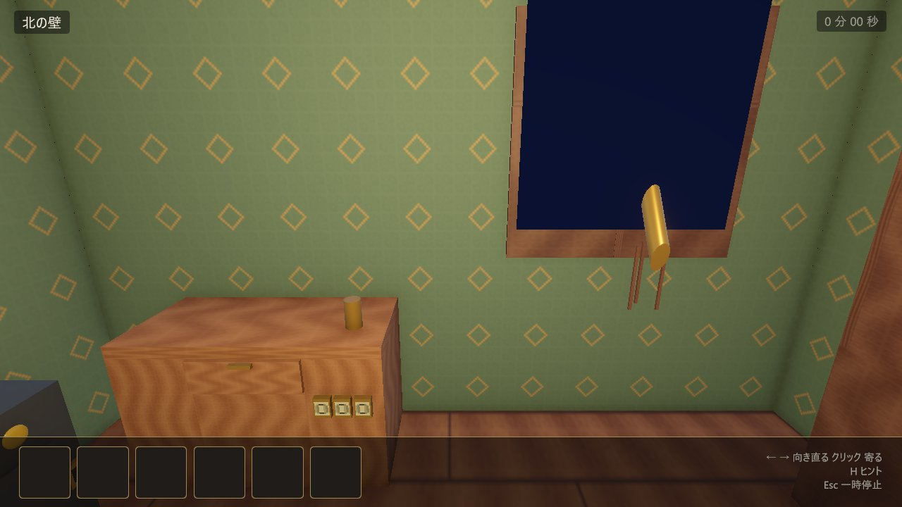 |

| 机の近景 | 真鍮の筒の底（手がかり） | 引き出しが開く |
|---|---|---|
| 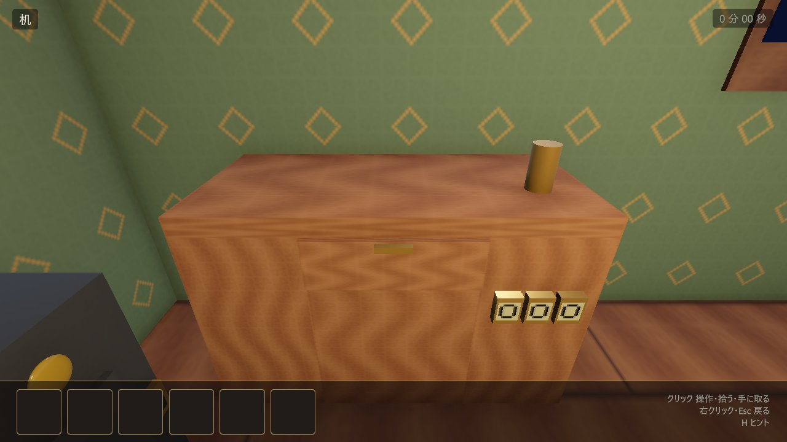 | 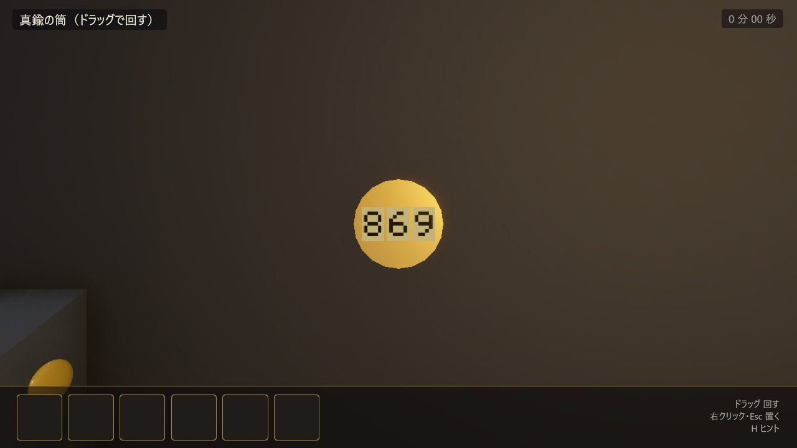 | 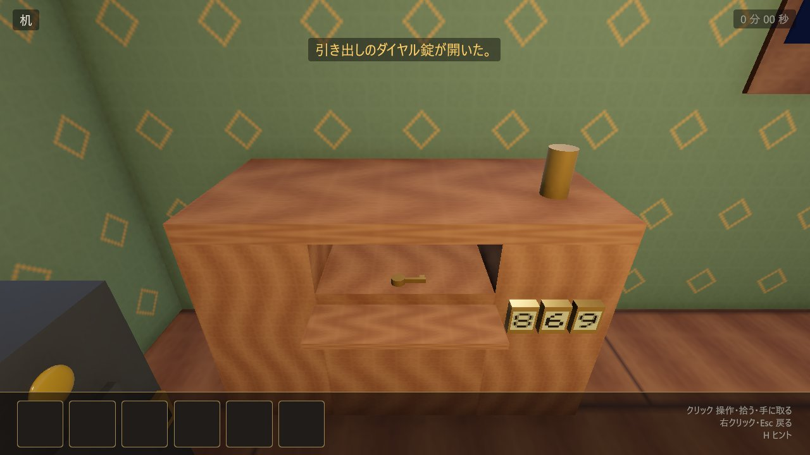 |

| キャビネットが開く | 星図の円盤の裏（手がかり） | 天球儀のリング |
|---|---|---|
| 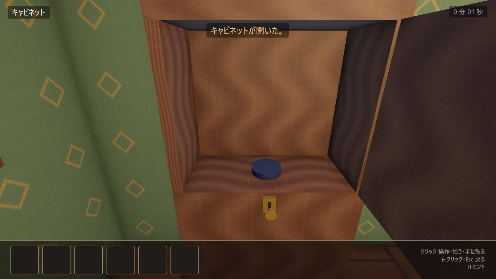 | 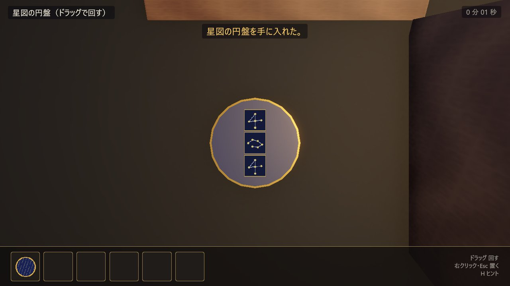 | 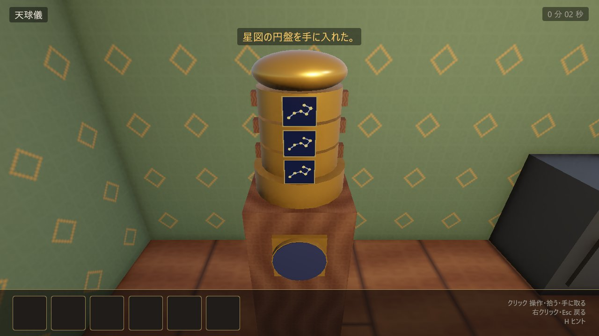 |

| 天球儀が開く | 本棚 | 天文書の裏表紙（手がかり） |
|---|---|---|
| 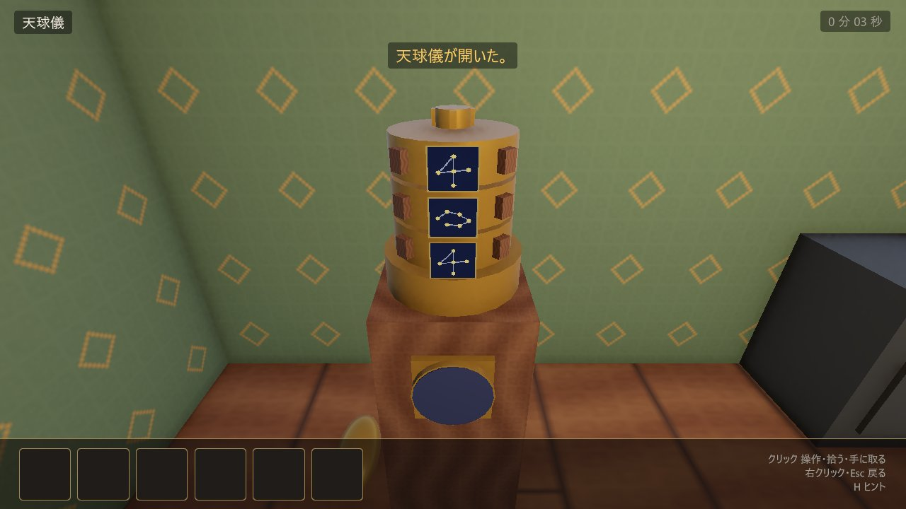 | 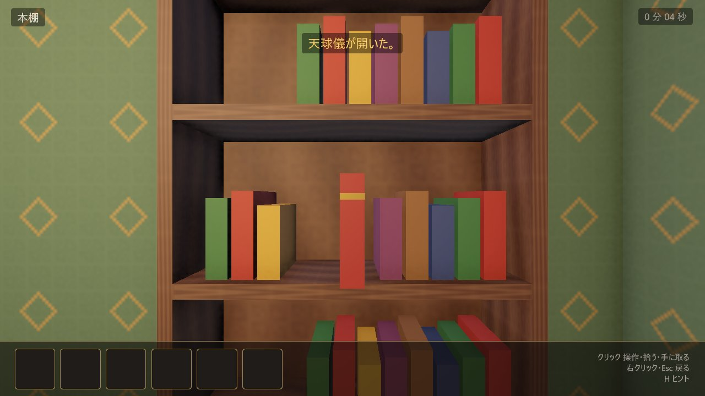 | 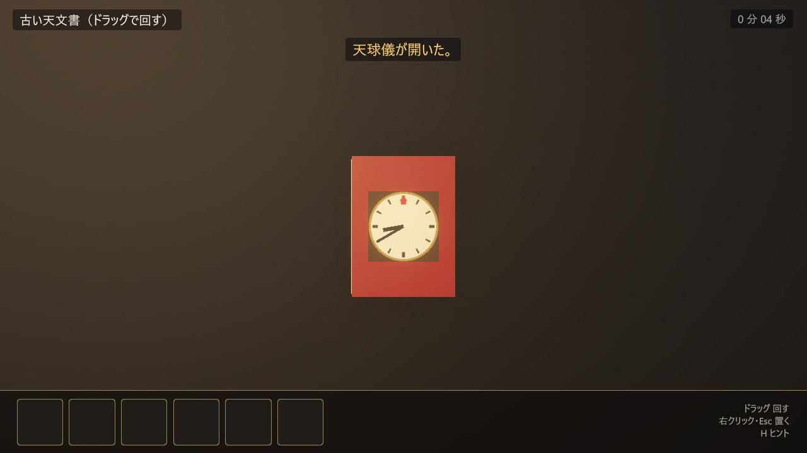 |

| 柱時計が開く | 望遠鏡の星（手がかり） | 金庫の宝石 |
|---|---|---|
| 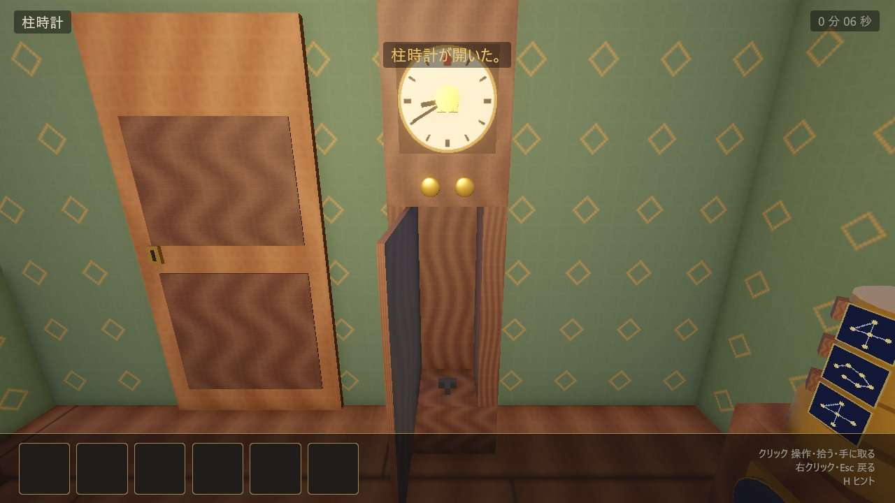 | 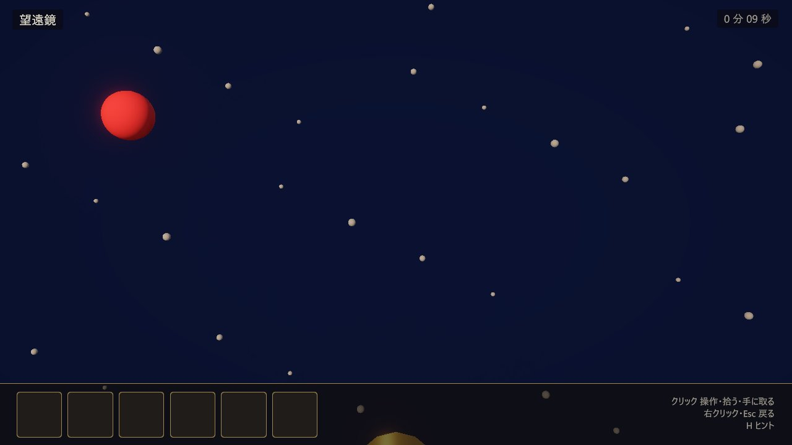 | 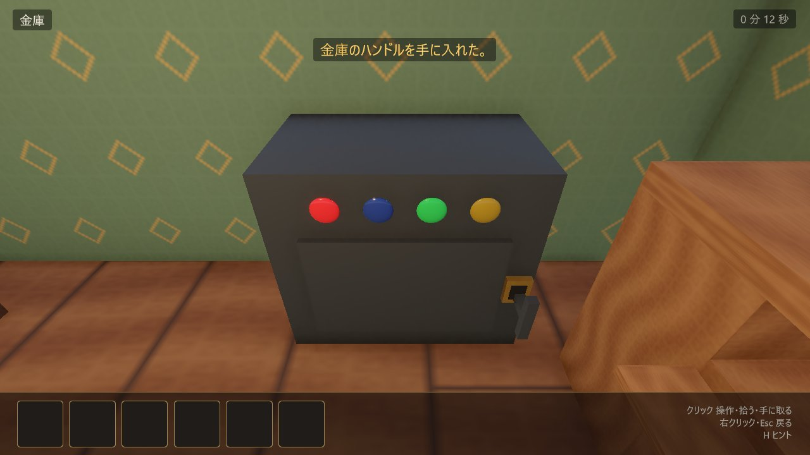 |

| ヒント（答えの段階） | 脱出 | 結果 |
|---|---|---|
| 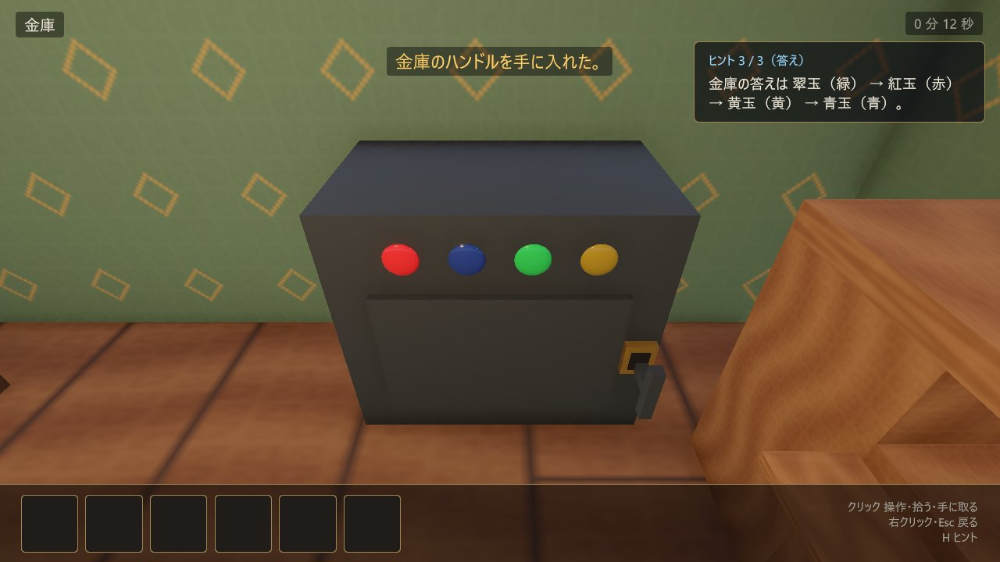 | 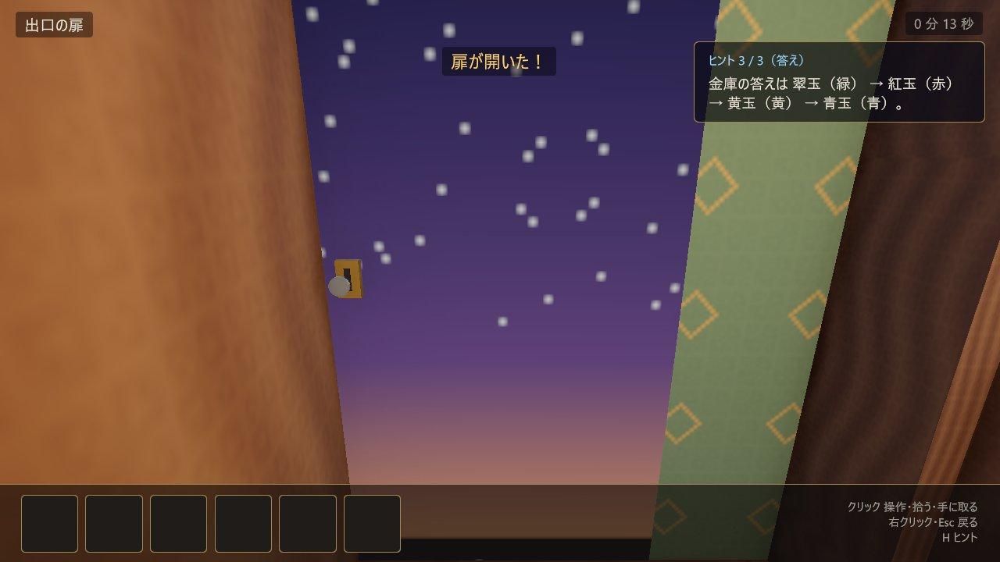 | 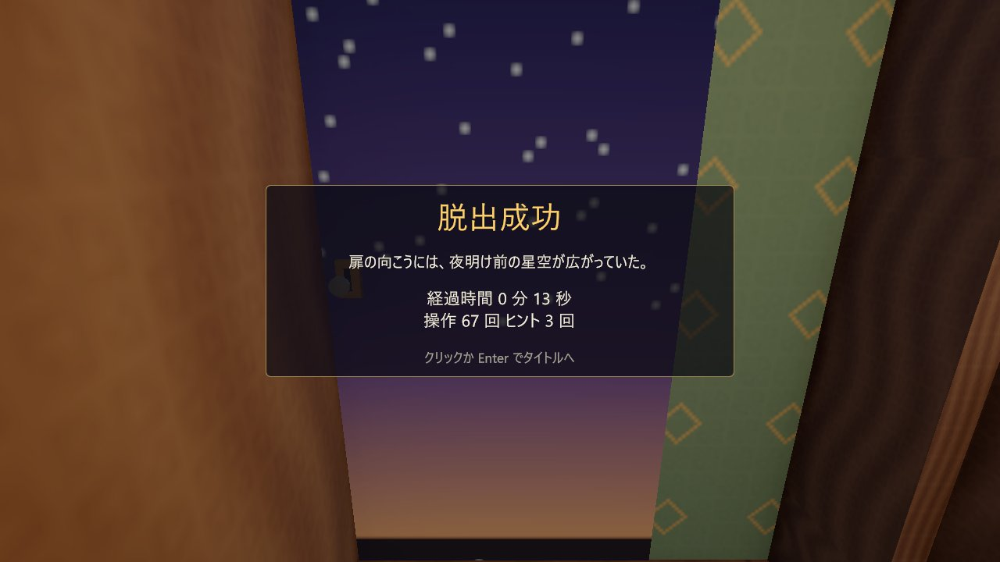 |

撮影記録：[current.json](current.json)
