# 050 検証記録

2026-11-27 実施（セッション 4）。

## 自動検証

| 項目 | 結果 |
|---|---|
| dev lint | 成功 |
| dev check | 成功（警告 0） |
| dev test | 成功。Core 90/90、App 32/32 |
| Unity EditMode | 196/196（パッケージ int-geometry 60・tile-motion 10・Core 90・App 32・Editor 4。Mono） |
| Unity PlayMode | 27/27（実シーン 11、共通の証跡公開 16） |
| Windows ビルド | 成功、StandaloneWindows64。ビルドの前の検証フック（`SummerBuildCheck`）が本番の台本と設定アセットを通過 |
| 壊した台本のビルド | 澄の屋上のイベントの条件を `sumii >= 25` に変えると、`dev build 050` が `台本の検証に失敗しました（Assets/Game/Data/Summer.txt）` `行 76：sumii は宣言されていない能力値です` で止まる。確かめてから戻した |
| ビルド起動 | dev capture で起動・全場面撮影・正常終了 |
| 証跡 | JPEG 品質 85、17 枚、1200×720 |
| 撮影の再現 | 同じビルド（Build GUID `91ab3b108453427d8027e689f85785d2`）で 2 回撮影し、17 枚全ての SHA-256 が一致した（1 回目 `20261127T142815Z-d496a635`、2 回目 `20261127T142849Z-d4aa4c08`＝[公開中の記録](current.json)。1 回目の記録は次の公開の整理で消える）。画像世代 `aeba744359f47c1b` はセッション 3 のビルドの撮影とも同じ |
| 固定ハッシュ | 台本の指紋 `77A8CB6A`。テスト用の小さな台本の最終ハッシュ `0x31B33CE7`、本番の台本・シード 2026 の操縦役の最終ハッシュ（先輩 `0xE8E4C4BA`・同級生 `0xFAD00C13`・成り行き `0xA2795083`）が .NET と Mono で一致。撮影の最終状態は `0xE4FE3AE5` |
| 題材固有テスト | 同日排他イベントは重複しない（小さな台本の乱択 300 シード・本番の台本の 3 方針 × 30 シードで、枠ごとに高々 1 本・`@exclusive` の組が同じ日に出ない・先に選ばれた方が勝つ・同じ優先度は定義の順）／条件を満たさない ED に入らない（好感度 29・30 とフラグの有無の境界、乱択 300 シードと 3 方針 × 30 シードで、選ばれた ED の条件が成り立ち上位の ED の条件が成り立たない）／能力値の範囲外逸脱なし（上限・下限のちょうどと 1 超えで飽和、乱択 200 シードの全命令で範囲内、本番の台本の乱択 100 シードで区間の見積もりが実際の値を含む、範囲外の初期値・逆向きの幅・成り立たない条件をコンパイルで拒否） |
| 完了判定 | 30 日終了で条件別 ED（3 方針が 40 シードの全てで狙った ED：先輩・同級生・天文部の夏。実シーンで仮想キーボードだけで 30 日を遊んで同級生の ED と結果画面に届く）／シード固定でイベント列一致（同じシードと命令の列で記録とハッシュが一致、行動の乱数を余分に引いてもイベントの列が同じ、セーブから再開しても同じ続きと結末） |

撮影の台本は、撮影のシード（1）の試合で、先輩の方針の操縦役（シード 7）の判断を遊ぶときと同じ入力（クリック・キー）にして、1 手ごとに 20 Tick（1/3 秒）進める。途中で 10 日目の朝にタイトルへ戻り、「つづきから」で再開してから続ける。

## 画面

| タイトル | 操作説明 | 1 日目の朝 |
|---|---|---|
| 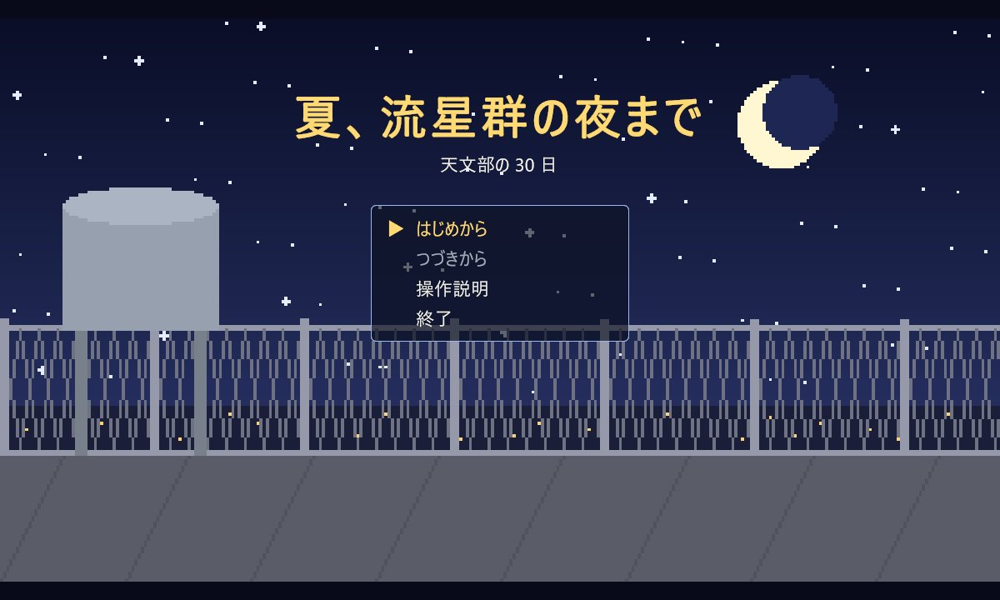 | 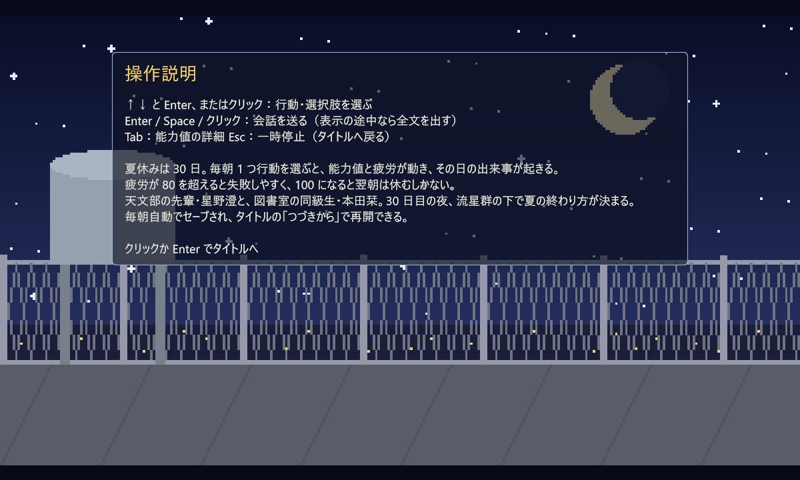 | 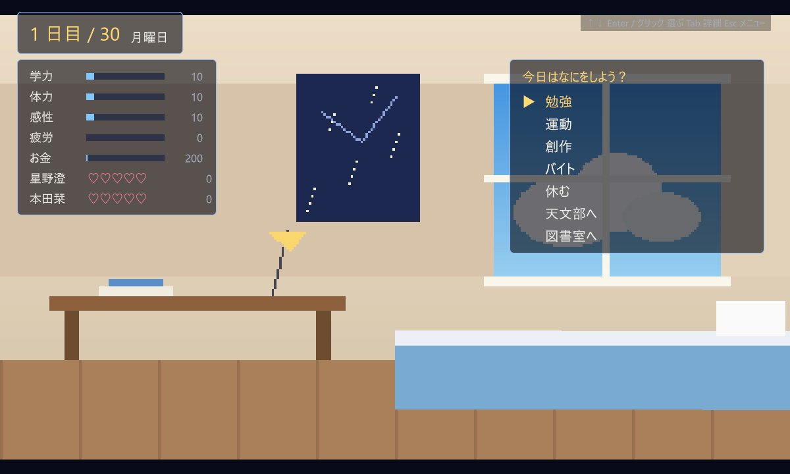 |

| 行動の結果 | 会話（文字送りの途中） | 天文部で先輩に会う |
|---|---|---|
| 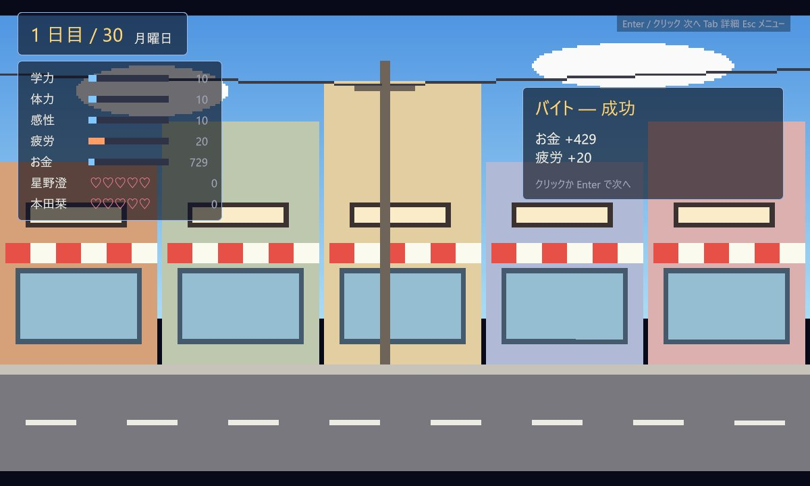 | 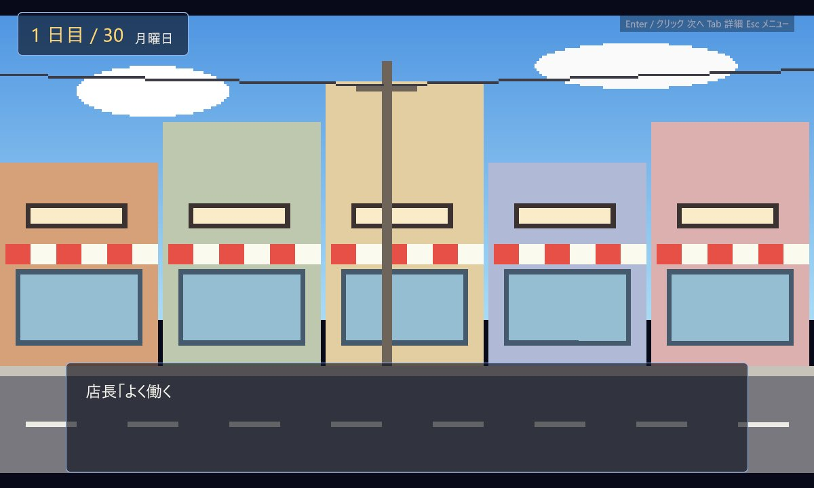 | 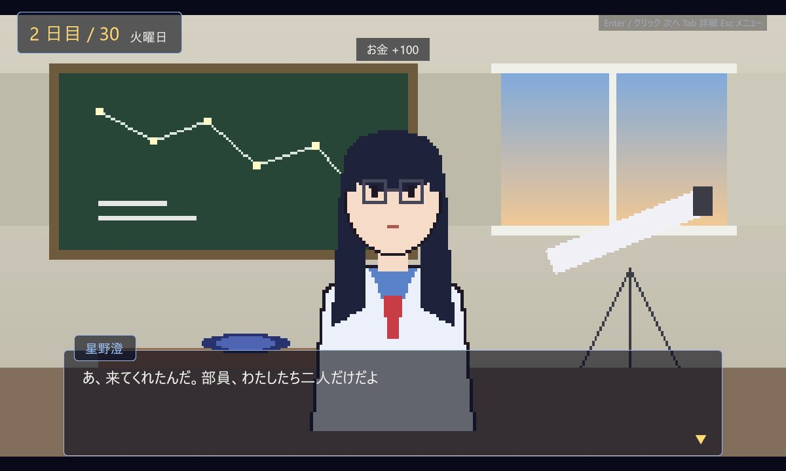 |

| 選択肢 | 能力値の詳細（Tab） | 日曜は図書室が閉まっている |
|---|---|---|
| 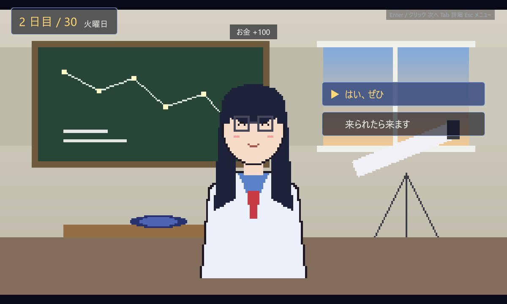 | 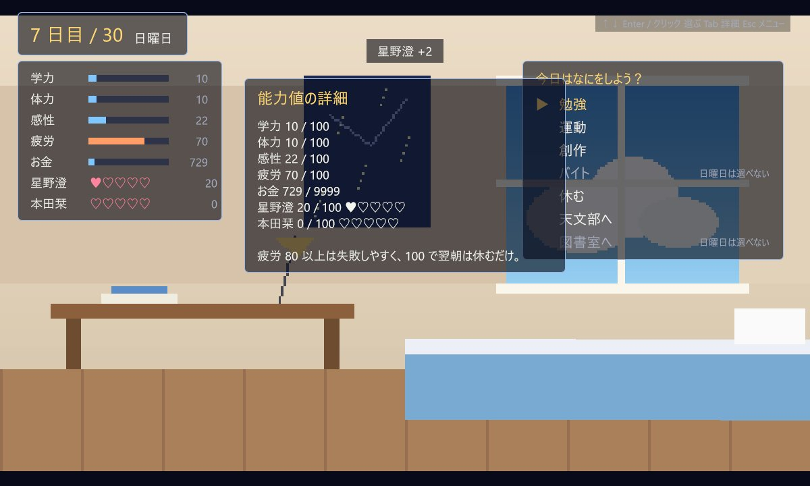 | 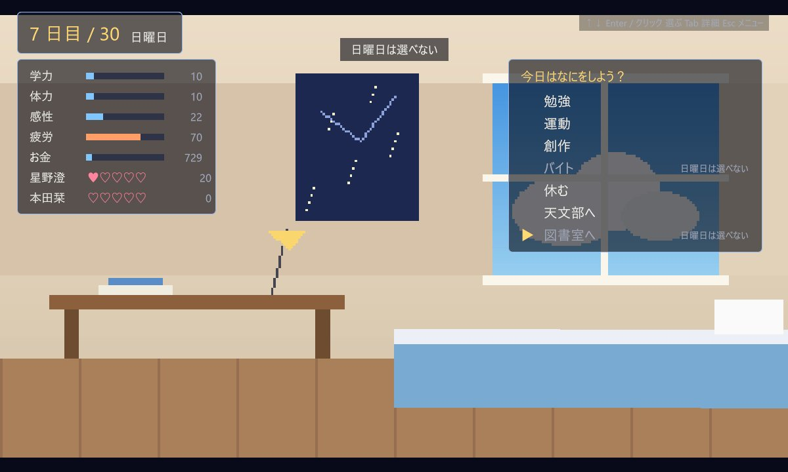 |

| 一時停止 | つづきから（10 日目の朝から） | 屋上の月 |
|---|---|---|
| 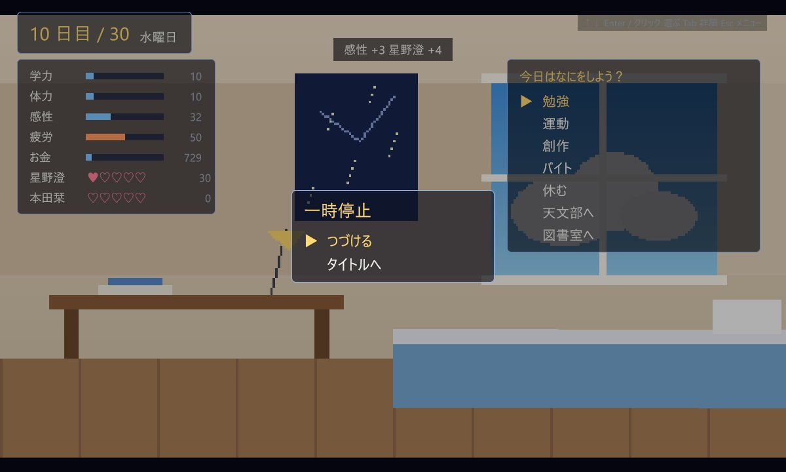 | 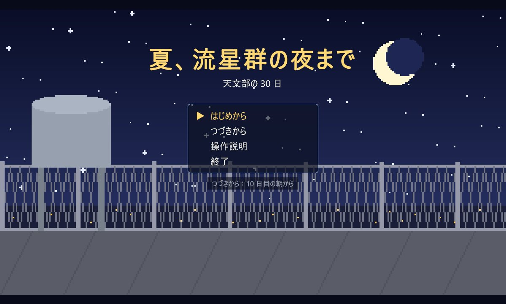 | 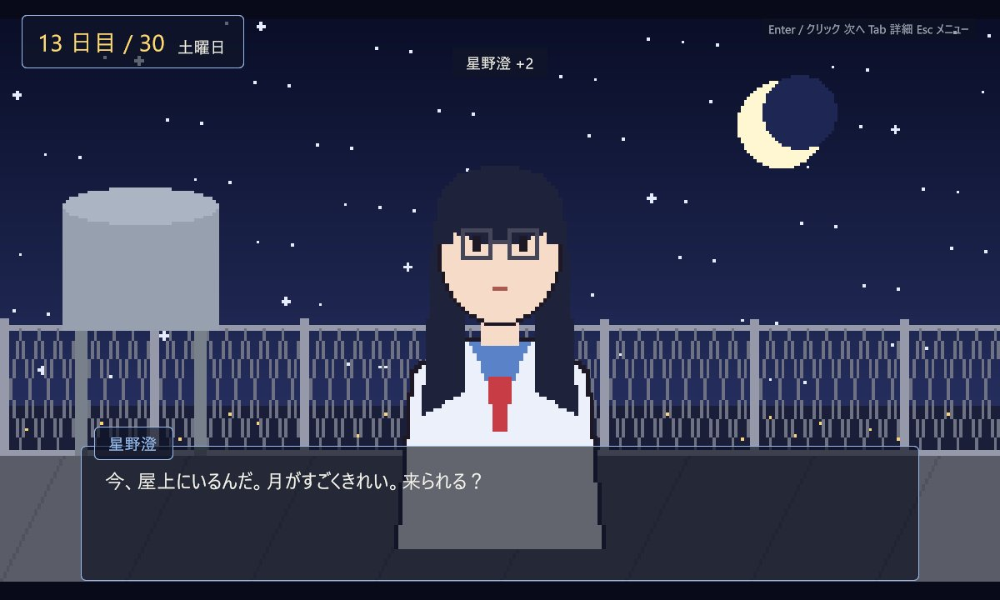 |

| 夏祭りの誘い | 流星群 | ED（先輩と星を数えた夏） |
|---|---|---|
| 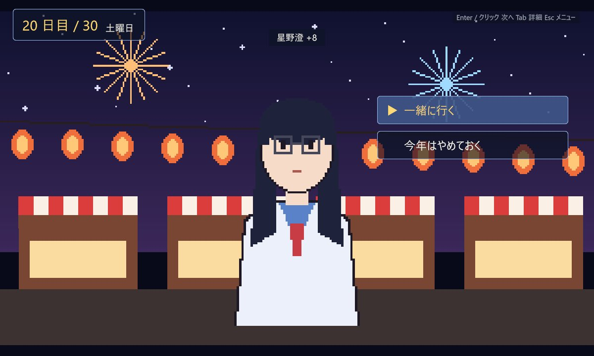 | 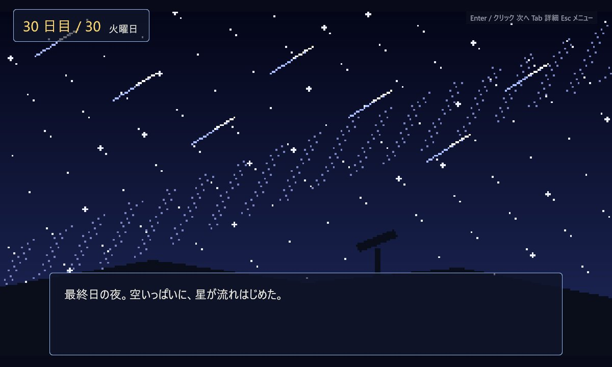 | 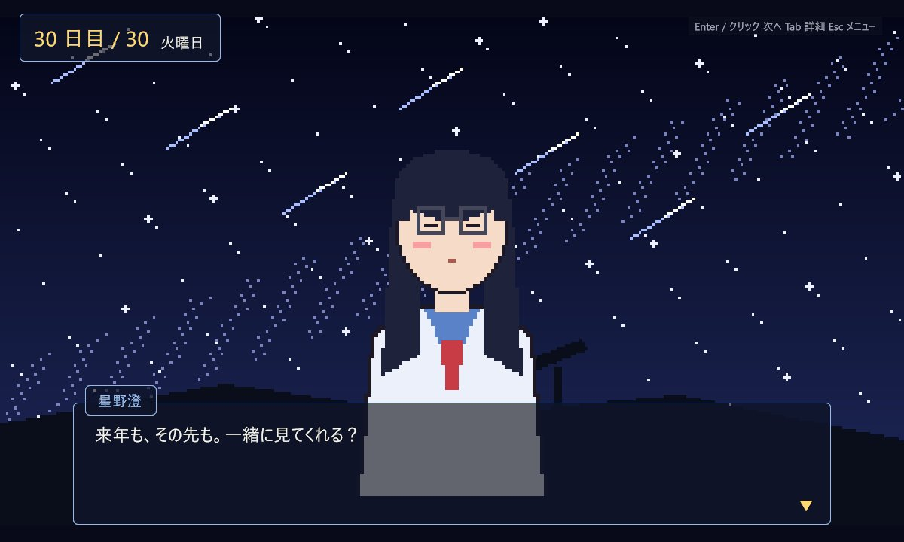 |

| 結果画面 | 壊れたセーブの案内 |
|---|---|
| 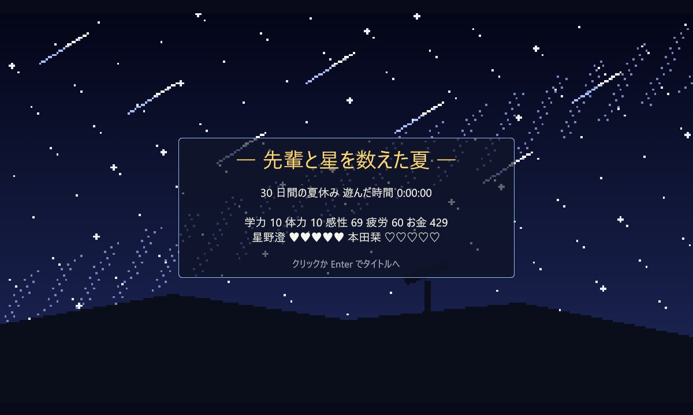 | 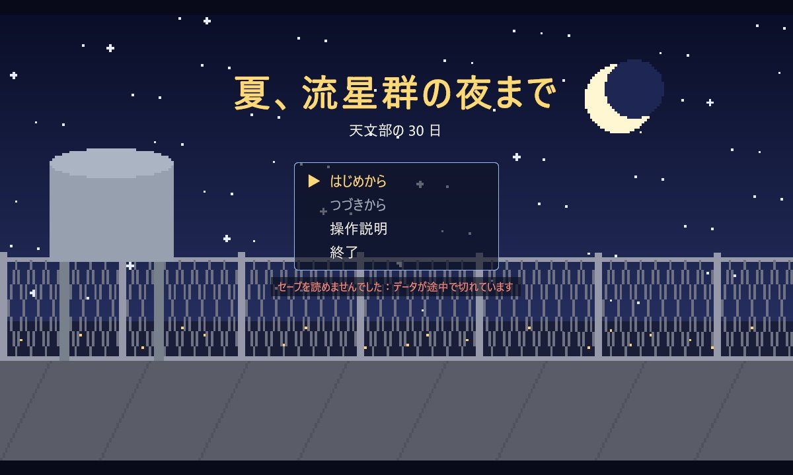 |

撮影記録：[current.json](current.json)
