# 050 検証記録

2026-11-27 実施（セッション 4）。同日、試遊の指摘（3 回とも何も起こらず既定の ED になった）に対応して、結末の目安（ヒント）を出し、テストを流し直して撮り直した。2026-11-28、動作承認を受領し、コードレビュー（P2-1〜P2-6・P3-1）に対応して撮り直した。

## 自動検証

| 項目 | 結果 |
|---|---|
| dev lint | 成功 |
| dev check | 成功（警告 0） |
| dev test | 成功。Core 106/106、App 38/38 |
| Unity EditMode | 218/218（パッケージ int-geometry 60・tile-motion 10・Core 106・App 38・Editor 4。Mono） |
| Unity PlayMode | 29/29（実シーン 13、共通の証跡公開 16） |
| Windows ビルド | 成功、StandaloneWindows64。ビルドの前の検証フック（`SummerBuildCheck`）が本番の台本と設定アセットを通過 |
| 壊した台本のビルド | 澄の屋上のイベントの条件を `sumii >= 25` に変えると、`dev build 050` が `台本の検証に失敗しました（Assets/Game/Data/Summer.txt）` `行 76：sumii は宣言されていない能力値です` で止まる。確かめてから戻した |
| ビルド起動 | dev capture で起動・全場面撮影・正常終了 |
| 証跡 | JPEG 品質 85、18 枚（夏祭りの予告を足した）、1200×720 |
| 撮影の再現 | 同じビルド（Build GUID `59fb96a5bd0d46dfb5ed3cf0f1c17913`）で 2 回撮影し、18 枚全ての SHA-256 が一致した（1 回目 `20261127T174427Z-5061b735`、2 回目 `20261127T174503Z-f7982b39`）。PR レビュー対応の後のビルドの撮影（`20261127T180540Z-c9280893`＝[公開中の記録](current.json)）も同じ画像世代だった |
| 固定ハッシュ | 台本の指紋 `0D305AD7`。テスト用の小さな台本の最終ハッシュ `0x31B33CE7`、本番の台本・シード 2026 の操縦役の最終ハッシュ（先輩 `0x1D23CE38`・同級生 `0x9DE01A7E`・成り行き `0xDC02ECF8`）が .NET と Mono で一致。撮影の最終状態は `0x13D7D914`。ヒントと予告のイベントで台本が変わり、指紋を混ぜるハッシュは全て変わった |
| 題材固有テスト | 同日排他イベントは重複しない（小さな台本の乱択 300 シード・本番の台本の 3 方針 × 30 シードで、枠ごとに高々 1 本・`@exclusive` の組が同じ日に出ない・先に選ばれた方が勝つ・同じ優先度は定義の順）／条件を満たさない ED に入らない（好感度 29・30 とフラグの有無の境界、乱択 300 シードと 3 方針 × 30 シードで、選ばれた ED の条件が成り立ち上位の ED の条件が成り立たない）／能力値の範囲外逸脱なし（上限・下限のちょうどと 1 超えで飽和、乱択 200 シードの全命令で範囲内、本番の台本の乱択 100 シードで区間の見積もりが実際の値を含む、範囲外の初期値・逆向きの幅・成り立たない条件をコンパイルで拒否） |
| 完了判定 | 30 日終了で条件別 ED（3 方針が 40 シードの全てで狙った ED：先輩・同級生・天文部の夏。実シーンで仮想キーボードだけで 30 日を遊んで同級生の ED と結果画面に届く）／シード固定でイベント列一致（同じシードと命令の列で記録とハッシュが一致、行動の乱数を余分に引いてもイベントの列が同じ、セーブから再開しても同じ続きと結末） |

撮影の台本は、撮影のシード（1）の試合で、先輩の方針の操縦役（シード 7）の判断を遊ぶときと同じ入力（クリック・キー）にして、1 手ごとに 20 Tick（1/3 秒）進める。途中で 10 日目の朝にタイトルへ戻り、「つづきから」で再開してから続ける。

## レビュー対応

| 指摘 | 対応 | テスト |
|---|---|---|
| P2-1 出来事のない日は、結果の段の日付が翌日になる。会話の前に効果が表示に出る | 結果の段では行動した日と曜日を出す（App が行動の前に覚える）。会話の始めに当たる効果（`@do`）は、その会話が終わるまで能力値の表示から除き、終わったときに案内する | `FlowTests.Report_ShowsTheDayOfTheAction_AndSceneEffectsWaitForTheScene`（3 方針 × 6 シードの全ての朝で、出来事なし・行動の後・夜だけの 3 通りを通る）・`SceneDoEffects_AppearWhenTheSceneEnds` |
| P2-2 セーブの記録と状態の整合を見ていない | 読み込みで、シードと記録の行動・選択を 1 日目から再生し、再生した日・能力値・フラグ・済み・記録がセーブと全て一致するときだけ再開する | `SaveCodecTests.SignedAndInRange_ButInconsistentWithTheLog_IsRejected`（能力値・フラグ・済み・日・シード）・`LogWithAMissingDay_OrADoubledAction_IsRejected`・`ChoiceWithoutTheEvent_IsRejected`、`SummerTests.Restore_RejectsStatesTheLogCannotProduce`・`Restore_ReplaysEveryMorning_OfRandomSummers` |
| P2-3 つづきからで遊んだ時間が 0 に戻る | セーブにその朝までの遊んだ時間（ミリ秒）を足し（版 2、版 1 は読まない）、再開でそこから数える | `FlowTests.Continue_RestoresPlayTime`、`SaveCodecTests.RoundTrip_RestoresTheSameMorning_AndPlayTime` |
| P2-4 ED を読む前にセーブを消す | ED の会話を読み終えて結果画面へ移るときに消す | `FlowTests.Save_IsKeptWhileReadingTheEnding` |
| P2-5 選べる行動が 1 つもない曜日を検出しない | 暦の全ての日に曜日で選べる行動があることをコンパイルで検証する（強制の行動には頼らない） | `CompilerTests.DayWithoutAnySelectableAction_IsRejected` |
| P2-6 詳細の裏の項目・会話にクリックが通る | 詳細をモーダルにした。開いている間は Tab と Esc で閉じるだけ（Esc は一時停止にしない）、開閉で画面の版を進め、HUD は項目の照合をしない | `FlowTests.Detail_IsModal`、`SummerSceneTests.Detail_IsModal_ClicksAndKeysDoNotReachBehind` |
| P3-1 操縦役が上限で ED に着かなくても成功する | 上限の命令の数で ED に着かなければ例外にする | `FlowTests.Autopilot_Throws_WhenTheLimitEndsBeforeTheEnding` |

任意の改善案（期限を過ぎた攻略条件の表示）は入れていない。

## PR レビュー対応

| 指摘 | 対応 | テスト |
|---|---|---|
| 強制の行動の「必ず成り立つ」を最終日の範囲だけで判定し、`weekday == tue`（30 日目が火曜）や `day >= 20` の正しい台本を拒否する | 全ての日の朝で必ず成り立つと言い切れるときだけ拒否する（d 日目の朝の値は d 日目の大きめの見積もりに含まれる） | `CompilerTests.Forced_IsRejectedOnlyWhenItHoldsOnEveryMorning`（最終日が月曜の小さな台本で `weekday == mon`・`day >= 5` が通り、`day >= 1`・`fatigue >= 0` は拒否） |
| 詳細を開いたままフォーカスを失うと、一時停止のメニューをクリックできない | クリックの遮断と詳細の表示を、遊んでいる画面（一時停止でない）に限る。一時停止の間は詳細を隠し、「つづける」で開いたまま戻る | `SummerSceneTests.FocusLossWithDetailOpen_PauseMenuStillTakesClicks` |

## 試遊の対応

| 指摘 | 原因と対応 |
|---|---|
| 3 回とも何も起こらずに ED に行った（条件が分からない） | ED の条件（好感度 70・感性または学力 50・夏祭り／読書会）と、夏祭りに誘われる条件（好感度 40 以上・高い方・お金 300）が画面のどこにも出ていなかった。台本に結末の目安（`@hint`）を書き、操作説明と Tab の詳細に出すようにした。ヒントの数値が ED の条件とずれないことを `DataTests.RealBook_HintsMentionTheEndingThresholds` で確かめる。さらに 15 日目の夜に夏祭りの予告（お金が 300 要る）のイベントを足した |

## 画面

| タイトル | 操作説明（結末の目安） | 1 日目の朝 |
|---|---|---|
| 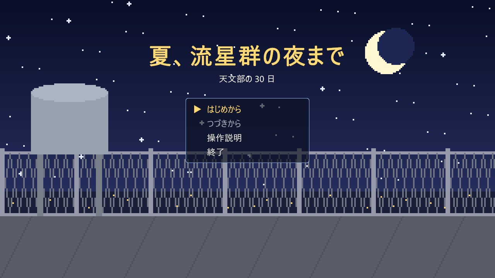 | 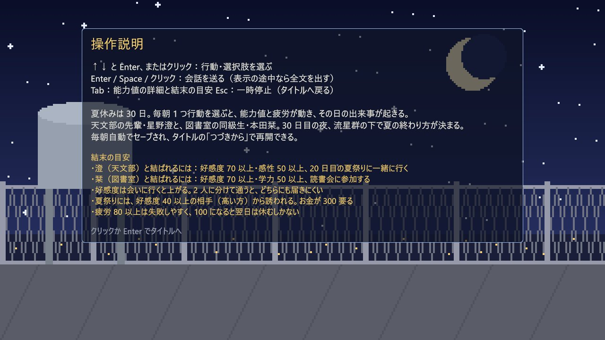 | 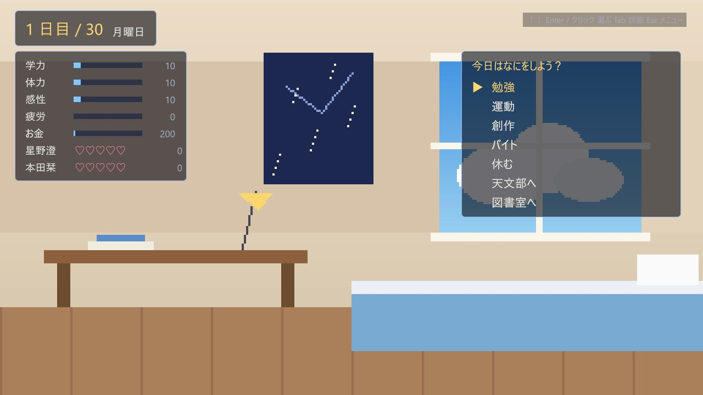 |

| 行動の結果 | 会話（文字送りの途中） | 天文部で先輩に会う |
|---|---|---|
| 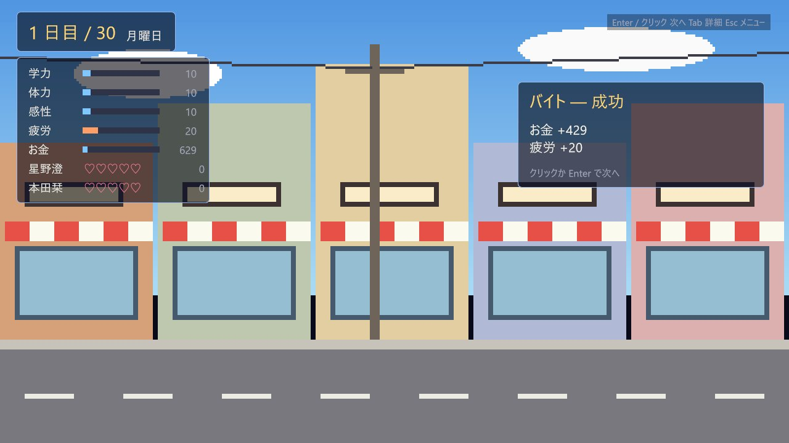 | 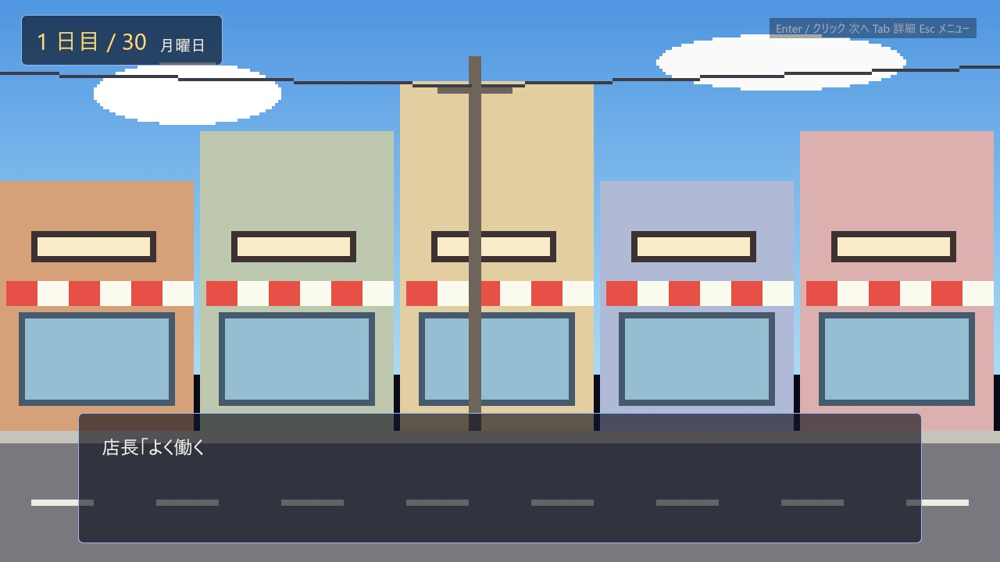 | 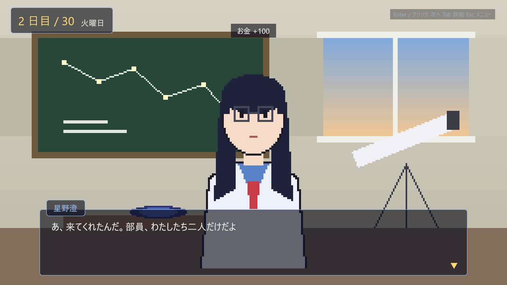 |

| 選択肢 | 能力値の詳細と結末の目安（Tab） | 日曜は図書室が閉まっている |
|---|---|---|
| 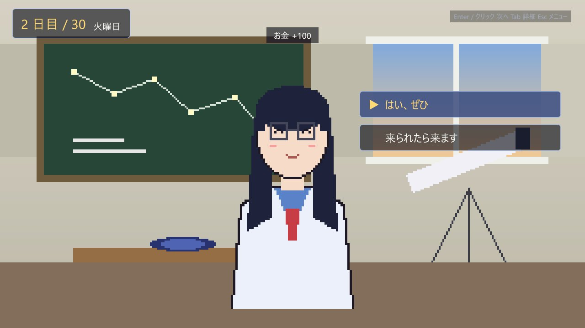 | 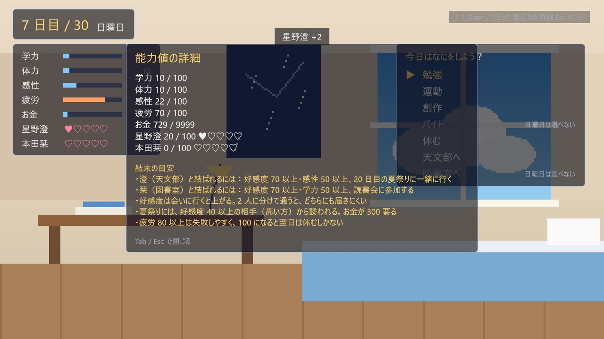 | 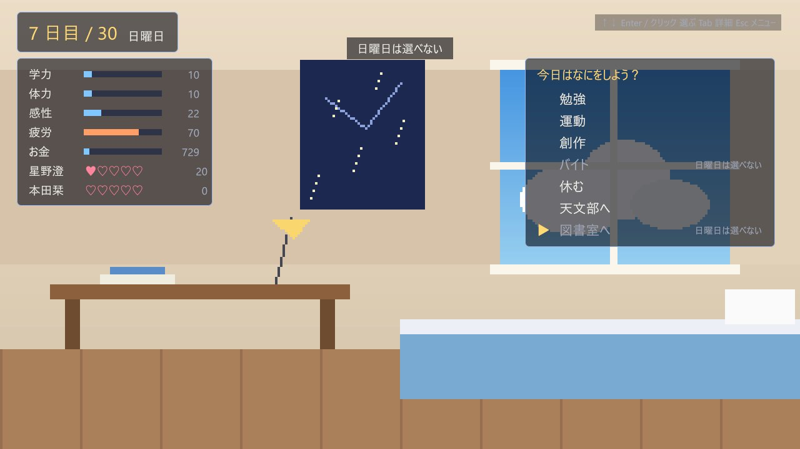 |

| 一時停止 | つづきから（10 日目の朝から） | 屋上の月 |
|---|---|---|
| 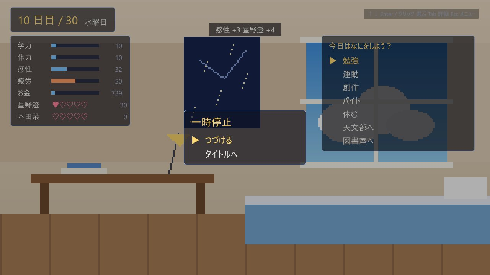 | 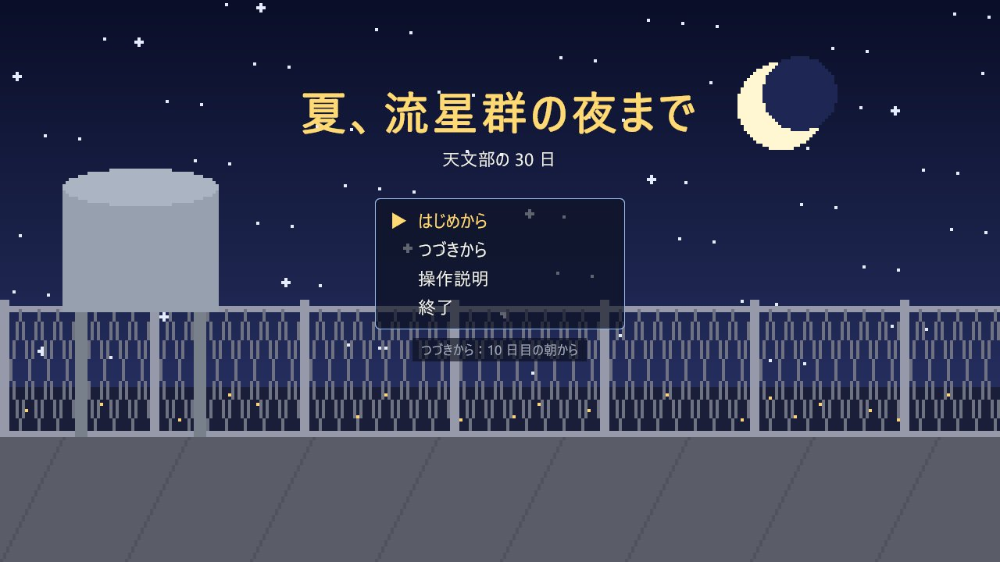 | 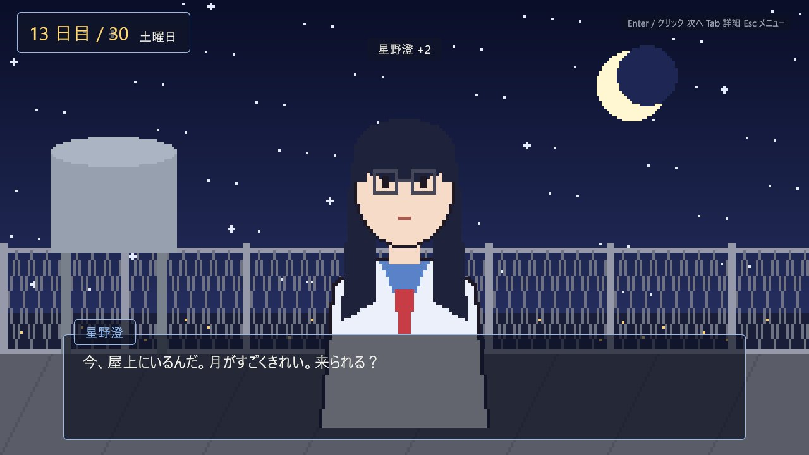 |

| 夏祭りの予告 | 夏祭りの誘い | 流星群 |
|---|---|---|
| 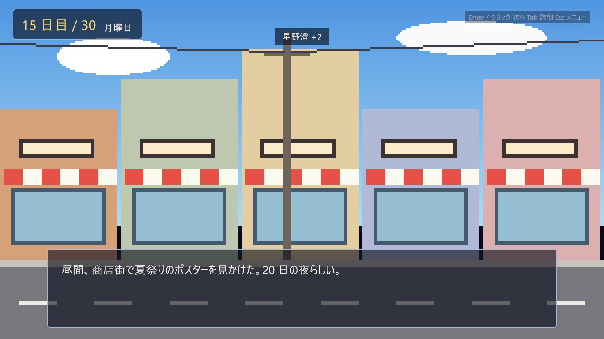 | 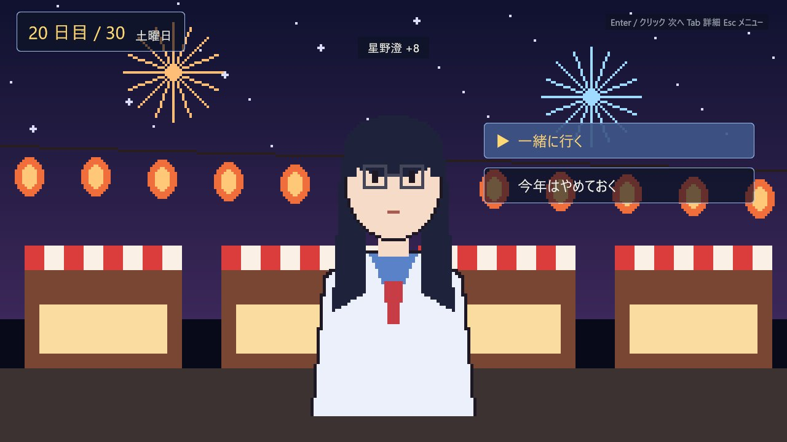 | 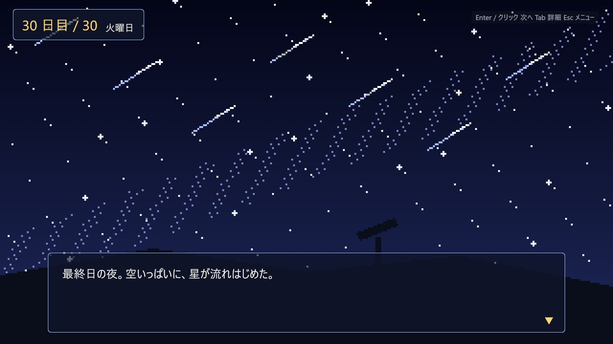 |

| ED（先輩と星を数えた夏） | 結果画面 | 壊れたセーブの案内 |
|---|---|---|
| 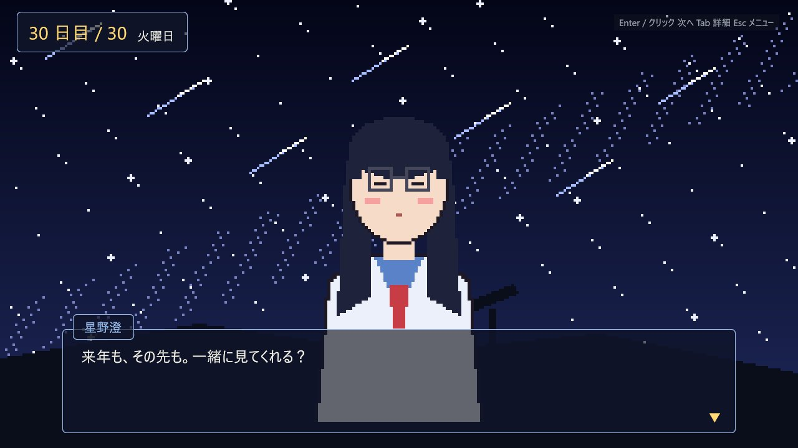 | 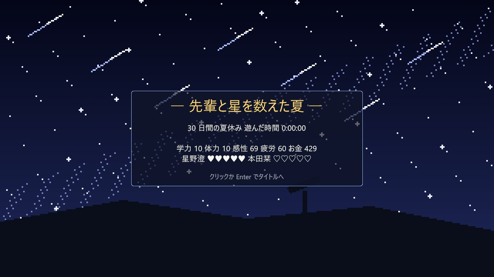 | 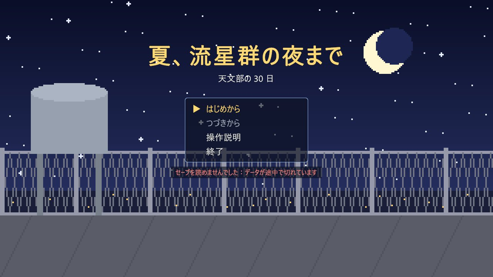 |

撮影記録：[current.json](current.json)
