# 053 検証記録

2026-11-28 実施（セッション 4）。同日の試遊を受けて仕様を変えた（GK なしの 3 人・壁の反射・切替ですぐ操作が効く・相手の CPU を弱め）後、レビュー対応（壁の反射を Tick の中の区間に分ける・役割の決め直し・赤の走る速さを試合の規則に）の後に撮り直した。

## 自動検証

| 項目 | 結果 |
|---|---|
| dev lint | 成功 |
| dev check | 成功（警告 0） |
| dev test | 成功。Core 66/66、App 19/19（比較実験の 2 件は明示実行だけ） |
| Unity EditMode | 157/157（パッケージ int-geometry 60・tile-motion 10・Core 66・App 19・Editor 2。Mono。比較実験の 2 件は明示実行だけ） |
| Unity PlayMode | 26/26（実シーン 10、共通の証跡公開 16） |
| Windows ビルド | 成功、StandaloneWindows64。ビルドの前の検証フック（`SoccerBuildCheck`）が設定アセットを試合と同じ規則で検証して通過 |
| 壊した設定のビルド | 設定アセットの相手の CPU の速さ（`CpuSpeedPercent`）を 500 にすると、`dev build 053` が `設定の検証に失敗しました（Assets/Game/Unity/SoccerSettings.asset）` `RedSpeedPercent は 30〜100（500）` で止まる。確かめてから戻した（仕様変更の前にシュートの速さ 5000 でも確かめた）。Editor のテストで壁の反発・相手の速さ・役割の決め直しの範囲外も拒否する |
| ビルド起動 | dev capture で起動・全場面撮影・正常終了 |
| 証跡 | JPEG 品質 85、12 枚、1280×720 |
| 撮影の再現 | 同じビルド（Build GUID `617d6d14d6d447faa4d312b6995c5407`）で 2 回撮影し、12 枚全ての SHA-256 が一致した（1 回目 `20261128T061025Z-56e941ad`、2 回目 `20261128T061042Z-93bdfb05`＝[公開中の記録](current.json)。1 回目の記録は次の公開の整理で消える） |
| 固定ハッシュ | 乱択の命令の通し（シード 2026・6,000 Tick）`0x5E141709`、CPU どうしの 2 分（シード 2026）`0x6CC97930` が .NET と Mono で一致。撮影の最終状態は `0xE47A66B4`（5 分・0-9） |
| 題材固有テスト | 得点はゴール通過時に一度だけ（ラインちょうど・1 単位越え、クロスバーの上・ポストの外は壁で跳ね返る、ポストに当たって戻る、得点の間に球を動かしても数えない、自陣のゴール、乱択の通しで得点の出来事とスコアが一致）／選手切替で入力が混線しない（押したままの移動キーが次の Tick から新しい選手に効く、切替と同じ Tick のパスは前の選手から 1 回だけ、自動の切替、実シーンで右を押したまま Space）／保持者以外の味方が支援位置へ動く（相手の陰の味方がパスコースの開いた 4〜10 m の支援の点へ。撮影の 05） |
| 完了判定 | CPU 相手に試合を完走（Core・App の CPU どうしの試合、実シーンで仮想キーボードだけの 1 分の試合が結果画面まで、撮影の 5 分の試合）／パス・シュート・守備の戦術差（赤の方針だけを変えた 3 シード × 3 分で、蹴り込むはシュートが多く、つなぐはパスが多く、引いて守るは自陣の深い位置で奪う） |

撮影の台本は、撮影のシード（1）の試合で、青も CPU（Full の強さ、バランス）、赤は既定の弱めの CPU（前から奪う・蹴り込む）。Tick だけを進めるので、毎回同じ画像になる。05・06 は役割の表示（F1）を出して撮った。CPU どうしでは遅い側が勝ち越す癖があり（README の「CPU の強さ」）、撮影の試合は赤の 9-0 で終わる。

## 画面

| タイトル | 相手の方針を選ぶ | 操作説明 |
|---|---|---|
| 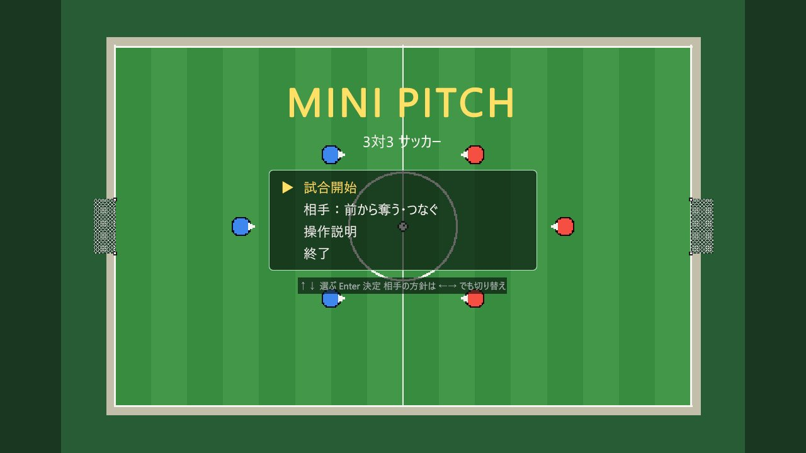 | 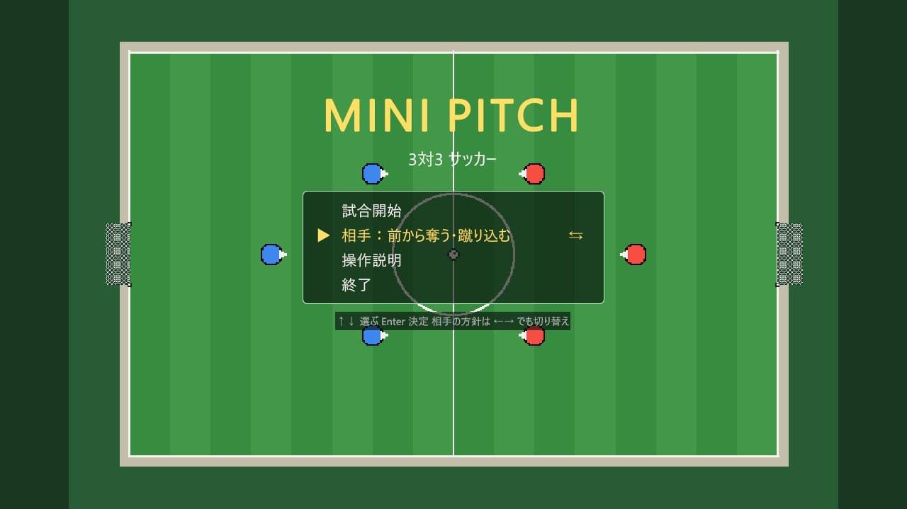 | 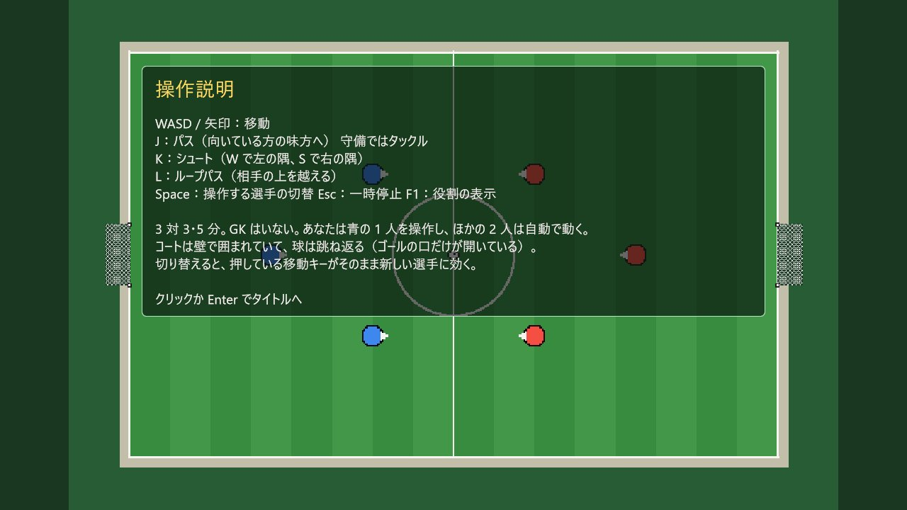 |

| キックオフ | 攻撃の役割（支援） | 守備の役割（寄せ・ゴール前・カバー） |
|---|---|---|
| 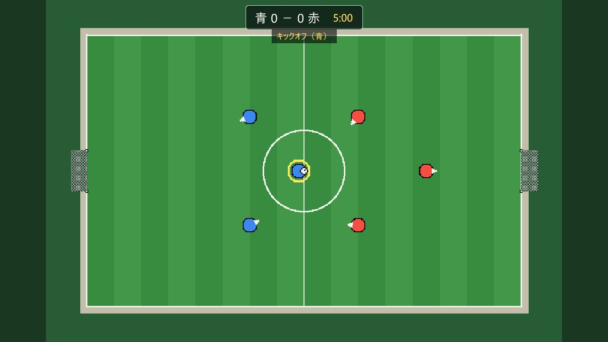 | 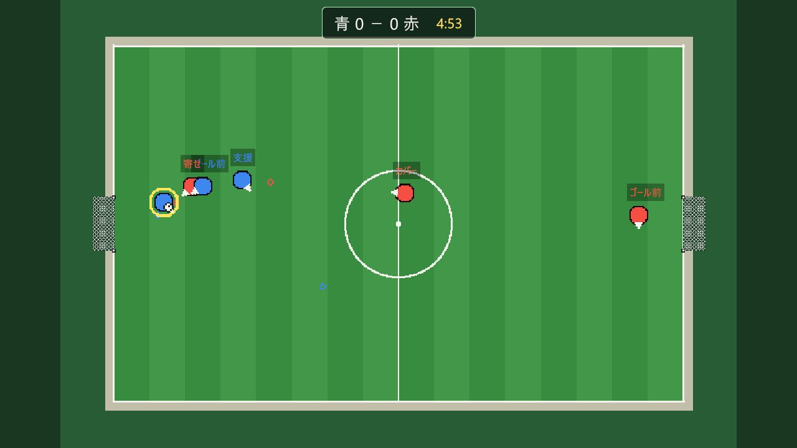 | 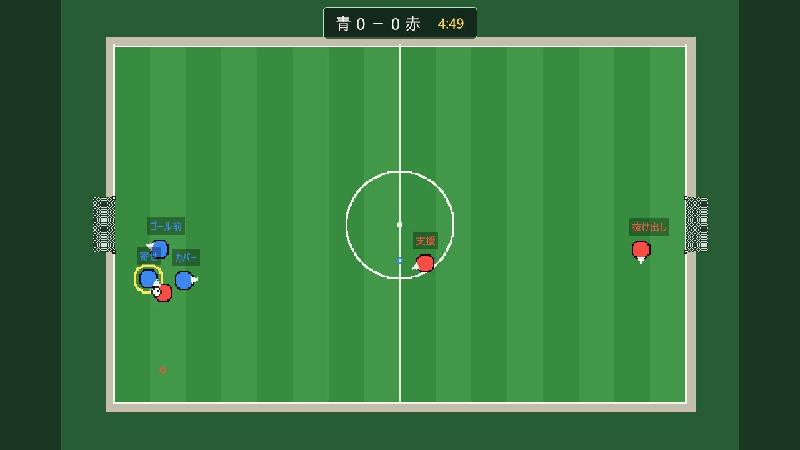 |

| ゴール | 浮き球（影と高さ） | 壁で跳ね返る球 |
|---|---|---|
| 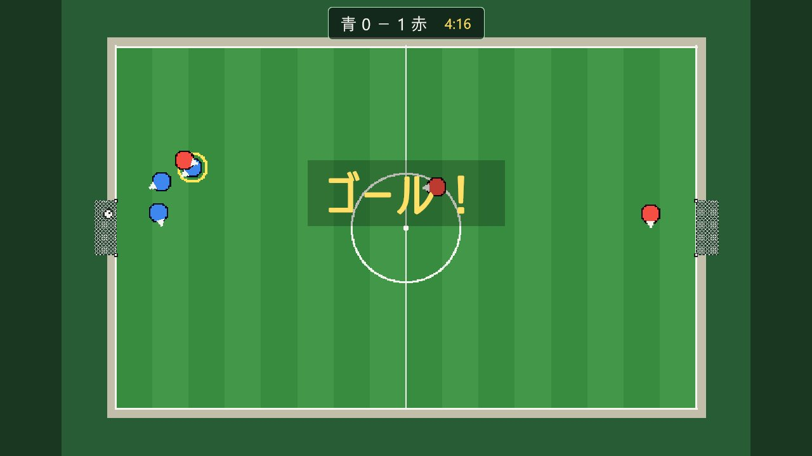 | 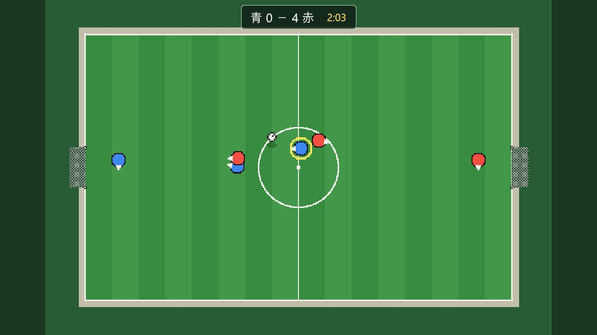 | 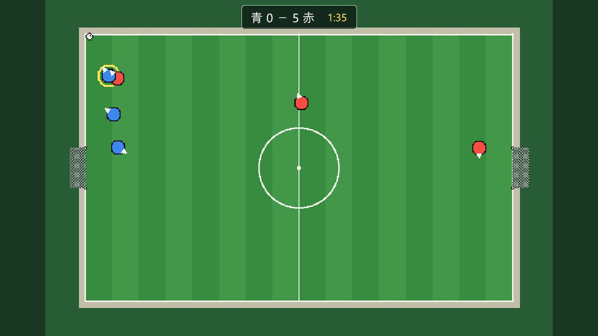 |

| 一時停止 | 試合終了 | 結果 |
|---|---|---|
| 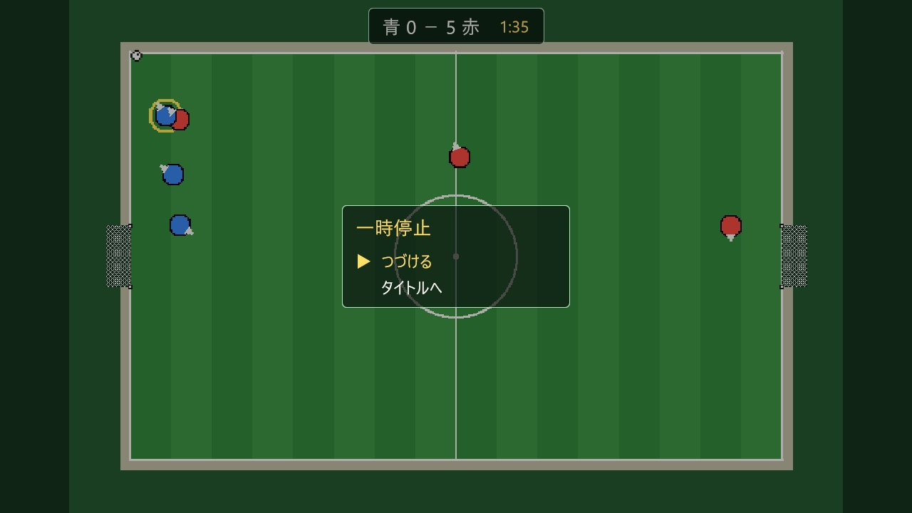 | 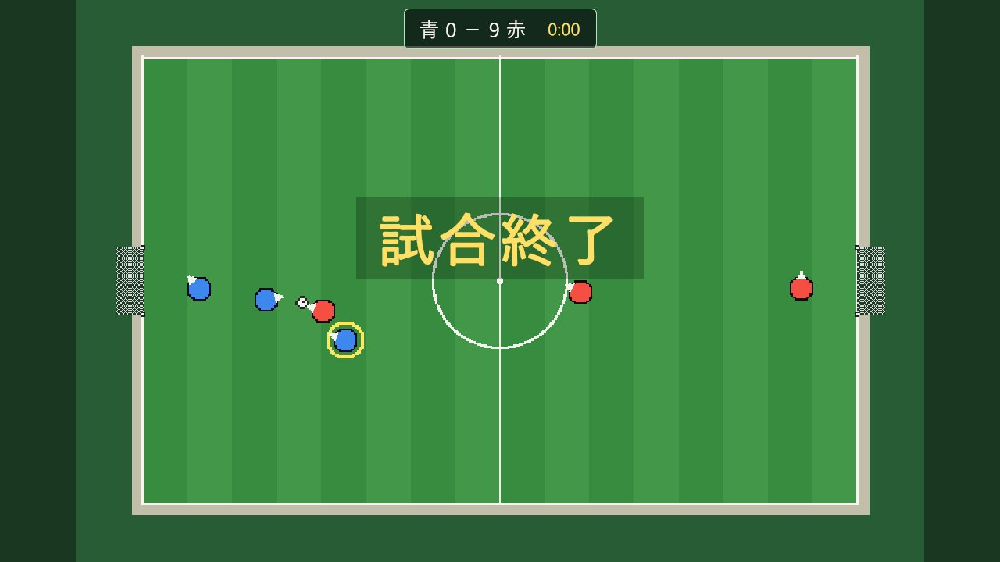 | 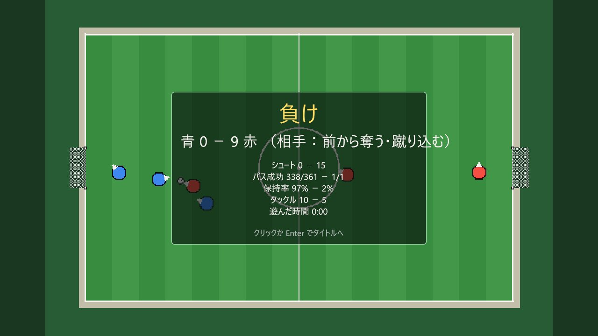 |

撮影記録：[current.json](current.json)
