# 053 検証記録

2026-11-28 実施（セッション 4）。

## 自動検証

| 項目 | 結果 |
|---|---|
| dev lint | 成功 |
| dev check | 成功（警告 0） |
| dev test | 成功。Core 53/53、App 17/17 |
| Unity EditMode | 142/142（パッケージ int-geometry 60・tile-motion 10・Core 53・App 17・Editor 2。Mono） |
| Unity PlayMode | 26/26（実シーン 10、共通の証跡公開 16） |
| Windows ビルド | 成功、StandaloneWindows64。ビルドの前の検証フック（`SoccerBuildCheck`）が設定アセットを試合と同じ規則で検証して通過 |
| 壊した設定のビルド | 設定アセットのシュートの速さを 5000 にすると、`dev build 053` が `設定の検証に失敗しました（Assets/Game/Unity/SoccerSettings.asset）` `ShotSpeed は 50〜600（5000）` で止まる。確かめてから戻した |
| ビルド起動 | dev capture で起動・全場面撮影・正常終了 |
| 証跡 | JPEG 品質 85、12 枚、1280×720 |
| 撮影の再現 | 同じビルド（Build GUID `705dee775ec6427b99943deda0d54bb5`）で 2 回撮影し、12 枚全ての SHA-256 が一致した（1 回目 `20261127T191011Z-09f0b94e`、2 回目 `20261127T191040Z-0bb938f9`＝[公開中の記録](current.json)。1 回目の記録は次の公開の整理で消える）。画像世代 `5479cf2ea3c8c31d` はセッション 3 のビルドの撮影とも同じ |
| 固定ハッシュ | 乱択の命令の通し（シード 2026・6,000 Tick）`0x19B63D66`、CPU どうしの 2 分（シード 2026）`0x6B88B074` が .NET と Mono で一致。撮影の最終状態は `0x996411BD`（5 分・3-0） |
| 題材固有テスト | 得点はゴール通過時に一度だけ（ラインちょうど・1 単位越え、クロスバーの上・ポストの外、ポストに当たって戻る、得点の間に球を動かしても数えない、自陣のゴール、乱択の通しで得点の出来事とスコアが一致）／選手切替で入力が混線しない（押したままの移動キーは離すまで新しい選手に効かない、切替と同じ Tick のパスは前の選手から 1 回だけ、自動の切替、実シーンで右を押したまま Space）／保持者以外の味方が支援位置へ動く（相手の陰の味方がパスコースの開いた 4〜10 m の支援の点へ。撮影の 05） |
| 完了判定 | CPU 相手に試合を完走（Core・App の CPU どうしの試合、実シーンで仮想キーボードだけの 1 分の試合が結果画面まで、撮影の 5 分の試合）／パス・シュート・守備の戦術差（赤の方針だけを変えた 3 シード × 3 分で、蹴り込むはシュートが多く、つなぐはパスが多く、引いて守るは自陣の深い位置で奪う） |

撮影の台本は、撮影のシード（1）の試合で、青も CPU（前から奪う・つなぐ）、赤は前から奪う・蹴り込む。Tick だけを進めるので、毎回同じ画像になる。05・06 は役割の表示（F1）を出して撮った。

## 画面

| タイトル | 相手の方針を選ぶ | 操作説明 |
|---|---|---|
| 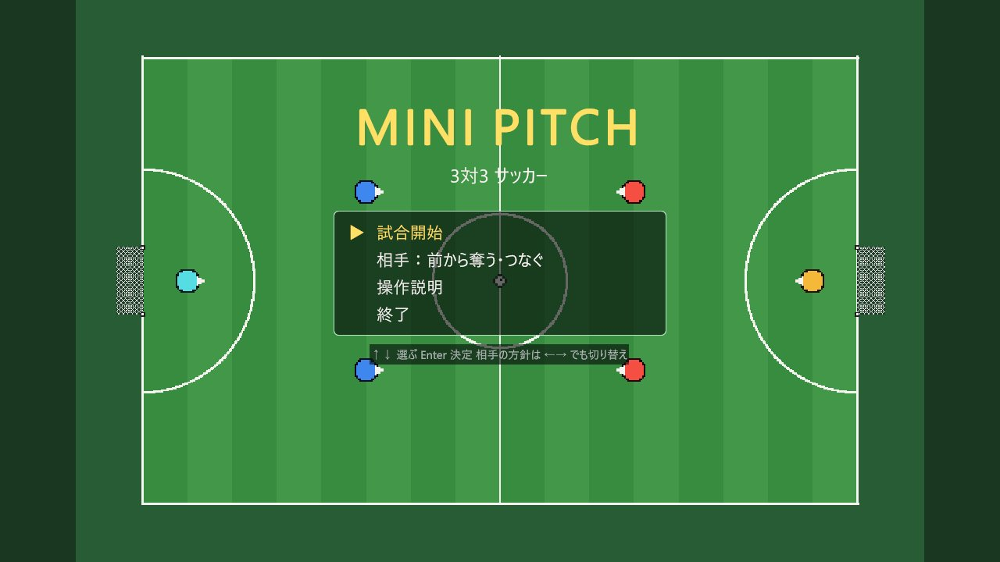 | 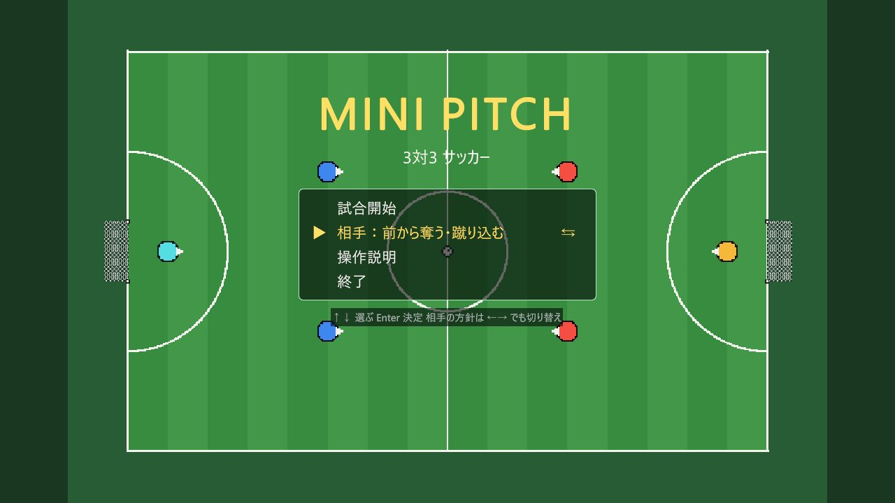 | 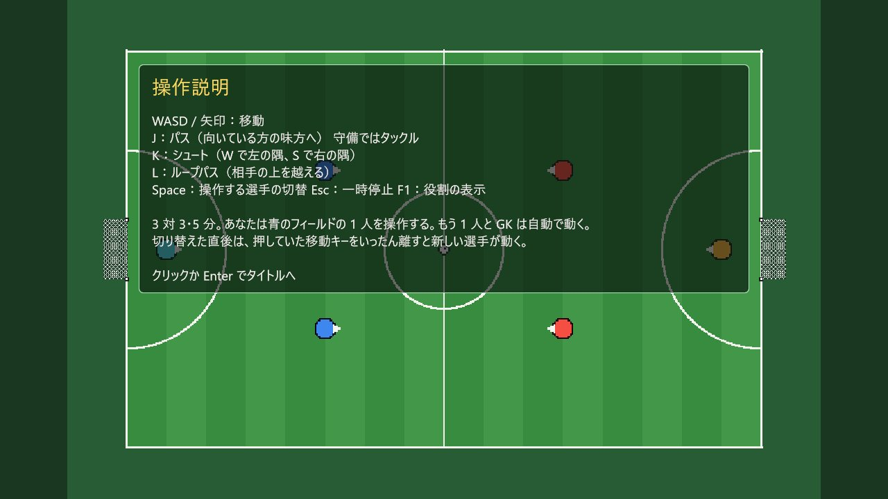 |

| キックオフ | 攻撃の役割（支援） | 守備の役割（寄せ・カバー） |
|---|---|---|
| 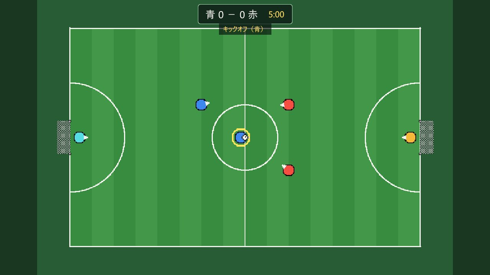 | 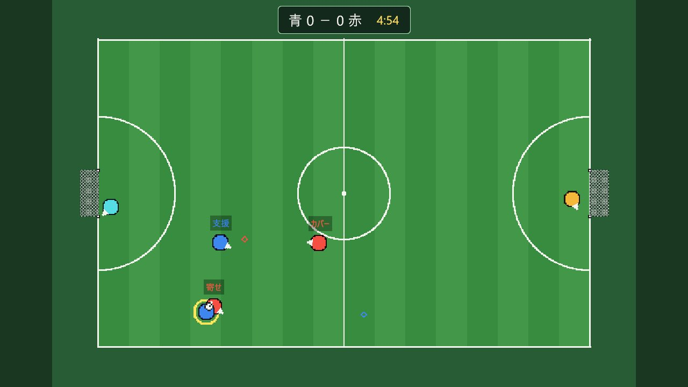 | 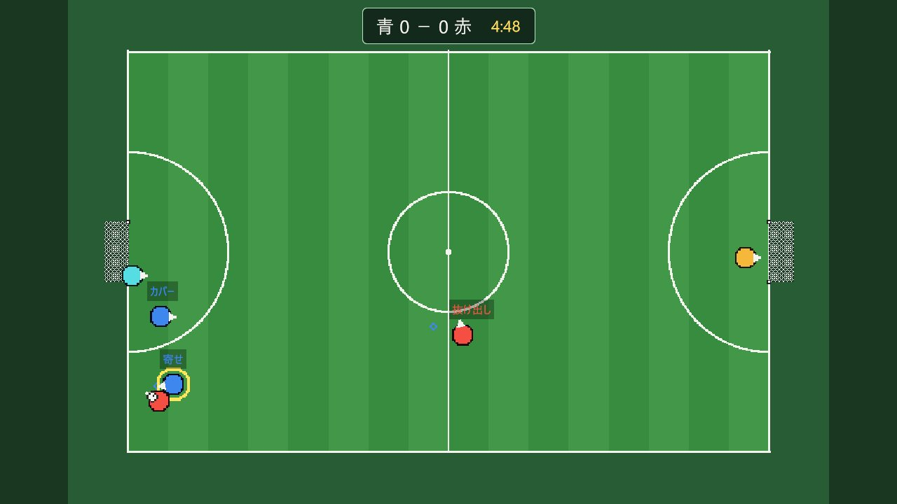 |

| 浮き球（影と高さ） | ゴール | スローイン |
|---|---|---|
| 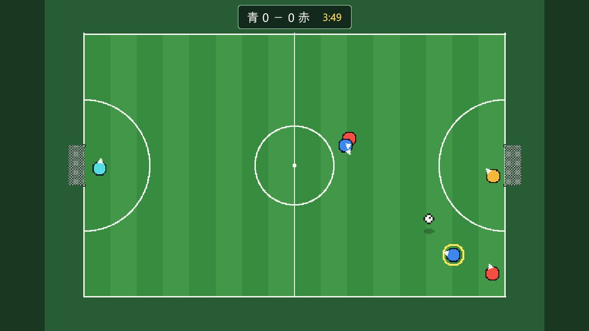 | 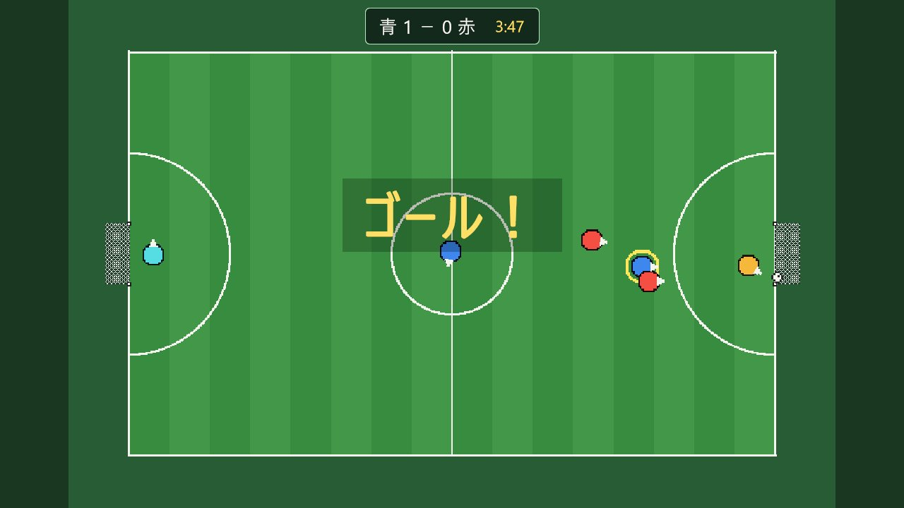 | 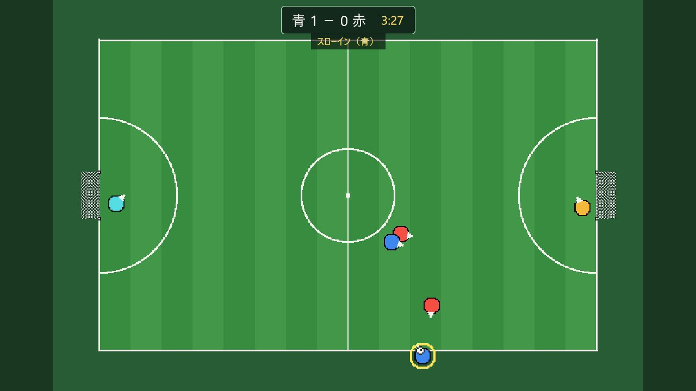 |

| 一時停止 | 試合終了 | 結果 |
|---|---|---|
| 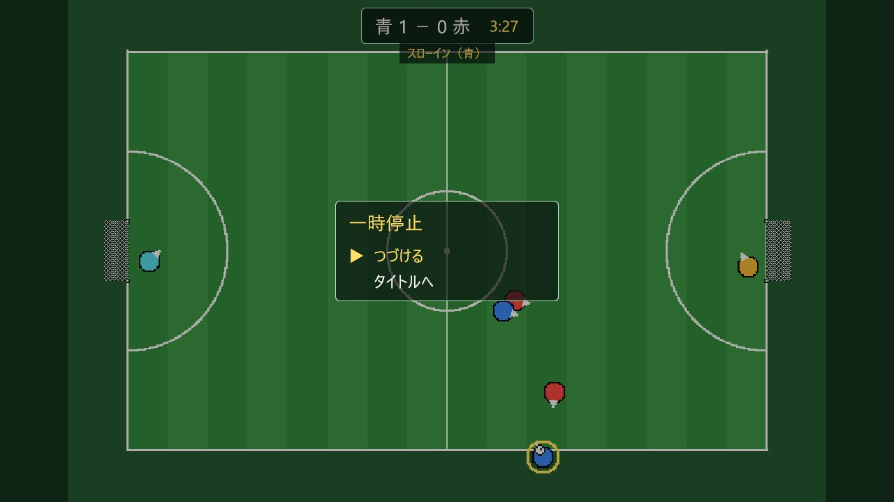 | 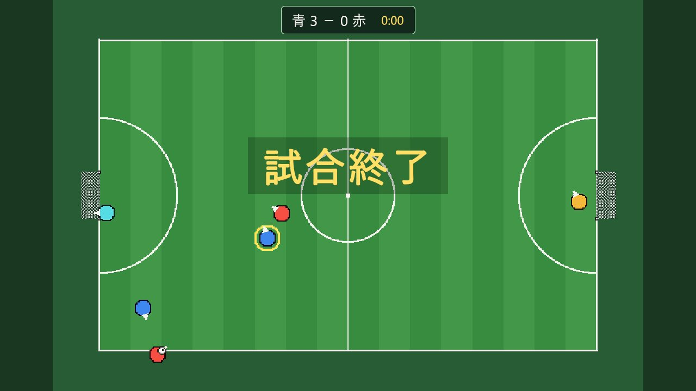 | 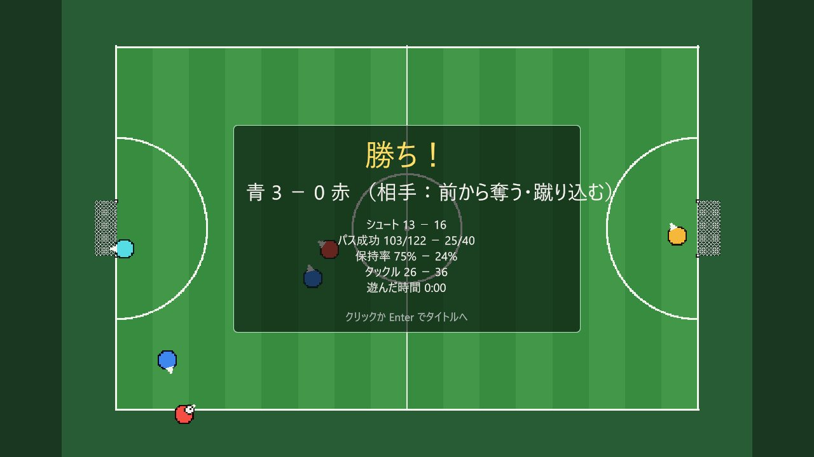 |

撮影記録：[current.json](current.json)
