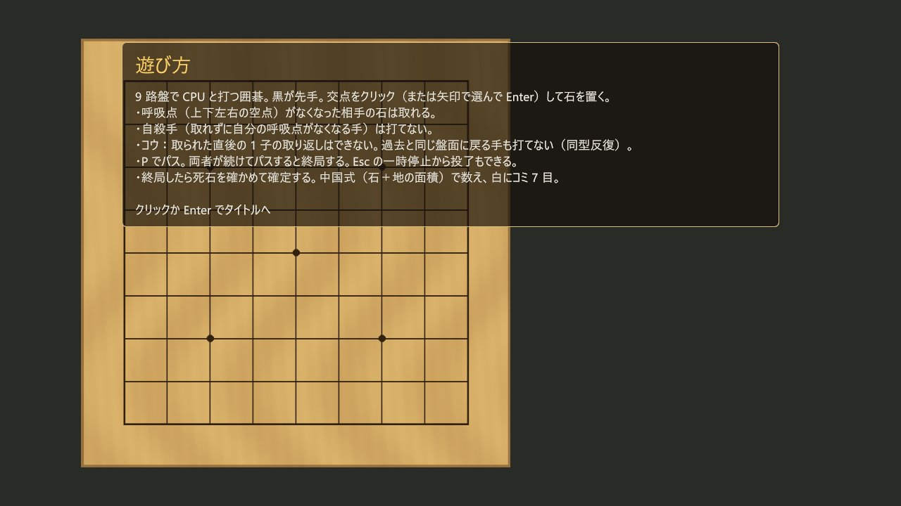
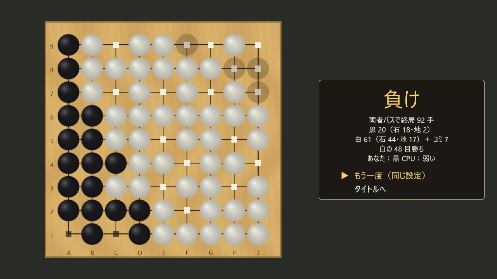

# 055 検証記録

2026-11-28 実施（セッション 3：Playable）。セッション 4 で PlayMode 実シーンのテストと撮影の再現を足して更新する。

## 自動検証

| 項目 | 結果 |
|---|---|
| Windows ビルド | 成功、StandaloneWindows64。ビルドの前の検証フック（`SekiteiBuildCheck`）が設定アセットを対局と同じ規則で検証して通過 |
| ビルド起動 | dev capture で起動・全場面撮影・正常終了（約 12 秒） |
| 証跡 | JPEG 品質 85、9 枚、1280×720 |

撮影の台本は、撮影のシード（1）の対局で、プレイヤー（黒）は操縦役（300 回の MCTS の手を矢印キーと Enter に変える）、CPU は「弱い」（500 回）。CPU の探索は 1 Tick に 20 回の分だけで進み、フレームの時間では回さないので、毎回同じ画像になる。最後の 1 枚は決まった局面（白がコウを取った直後）から始め、黒の取り返しのクリックが拒否されるところを撮った。

## 画面

| タイトル | CPU の強さを選ぶ | 遊び方 |
|---|---|---|
|  |  |  |

| 対局中（カーソル・最後の手） | CPU の考え中 | 一時停止 |
|---|---|---|
|  |  |  |

| 死石の確定 | 結果 | コウの拒否 |
|---|---|---|
|  |  |  |

公開中の撮影記録：[current.json](current.json)
