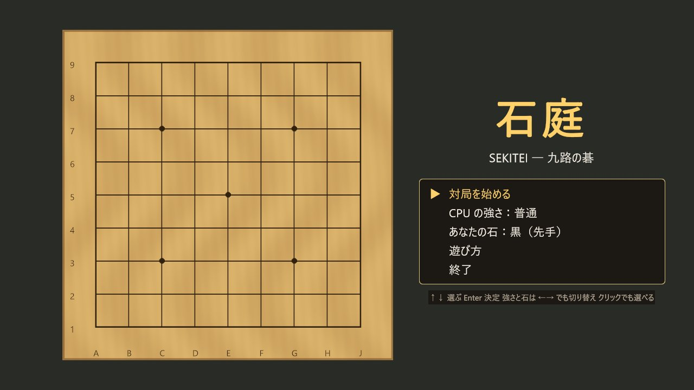
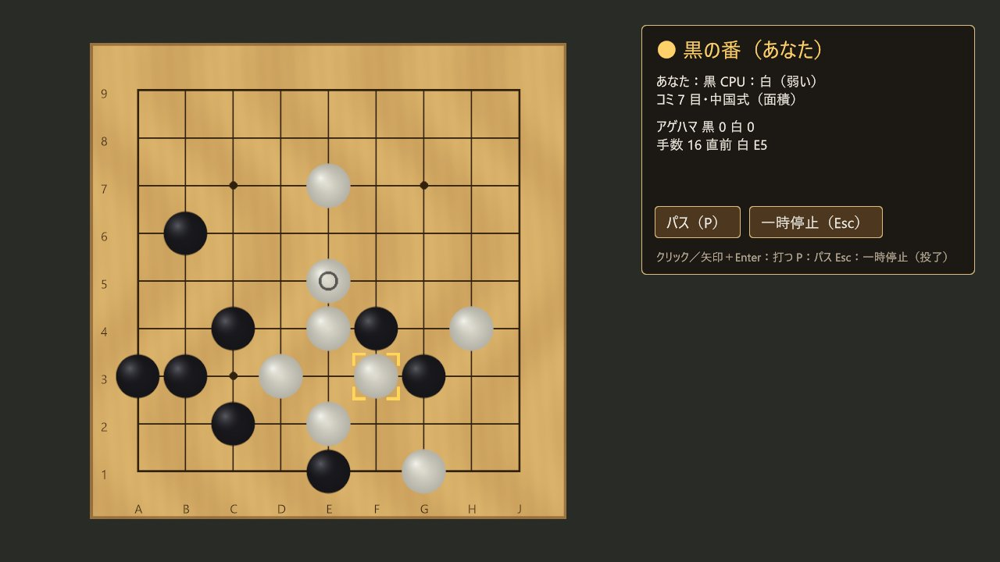
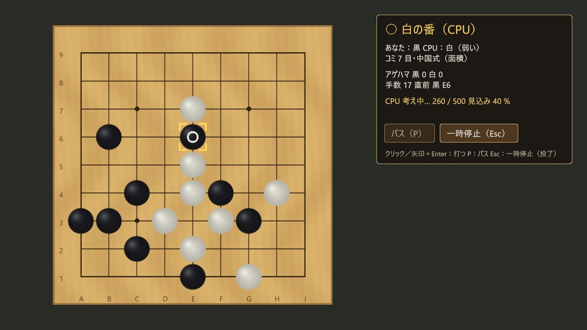
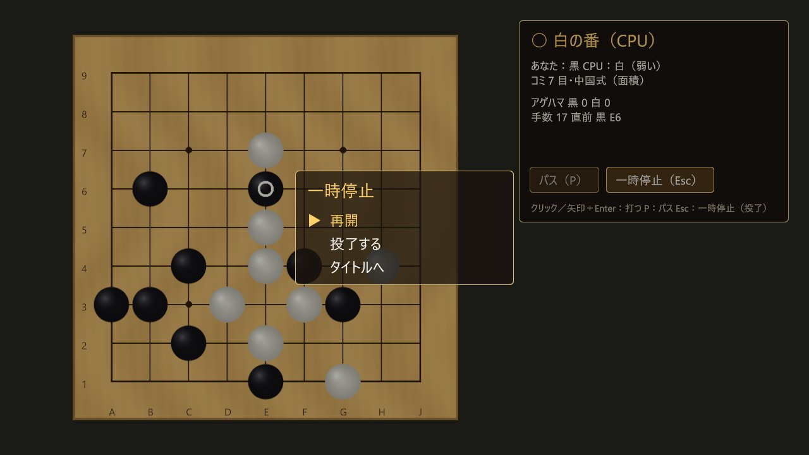
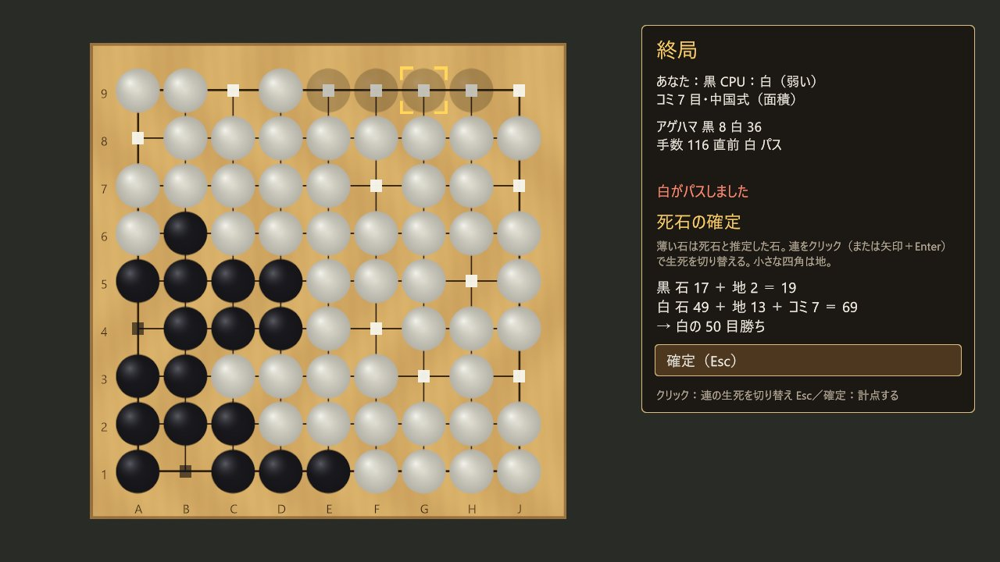
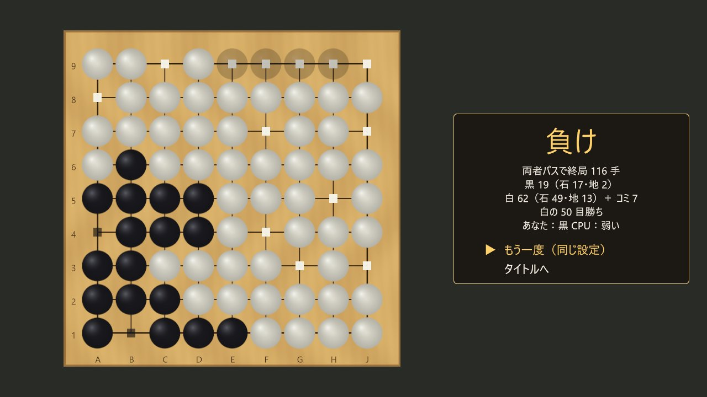

# 055 検証記録

2026-11-28 実施（セッション 4）。同日、レビュー対応の後に撮り直した（下の表はレビュー対応の後の値）。

## 自動検証

| 項目 | 結果 |
|---|---|
| dev lint | 成功 |
| dev check | 成功（警告 0） |
| dev test | 成功。Core 125/125、App 24/24（.NET 9） |
| Unity EditMode | 221/221（パッケージ int-geometry 60・tile-motion 10・Core 125・App 24・Editor 2。Mono） |
| Unity PlayMode | 28/28（実シーン 12、共通の証跡公開 16） |
| Windows ビルド | 成功、StandaloneWindows64。ビルドの前の検証フック（`SekiteiBuildCheck`）が設定アセットを対局と同じ規則で検証して通過 |
| 壊した設定のビルド | 設定アセットの `StrongPlayouts` を 0 にすると、`dev build 055` が `設定の検証に失敗しました（Assets/Game/Unity/SekiteiSettings.asset）` `StrongPlayouts は 1〜100000（0）` で止まる。確かめてから戻した。Editor のテストでコミ・回数・1 Tick の回数・考える時間（NaN）・音量（無限大）も拒否する |
| ビルド起動 | dev capture で起動・全場面撮影・正常終了（約 12 秒） |
| 証跡 | JPEG 品質 85、9 枚、1280×720 |
| 撮影の再現 | 同じビルド（Build GUID `2d265bdd8eb648e3abcb14261702e3ad`）で 2 回撮影し、9 枚全てが同じ画像世代 `bcc4d7d1d09cf42e`（SHA-256 が一致）になった（1 回目 `20261128T134020Z-c8a21758`、2 回目 `20261128T134026Z-aa86f63c`＝[公開中の記録](current.json)。1 回目の記録は公開の整理で消えた）。レビュー対応で木の候補（つなぐ眼埋め）と死石の推定の回し方が変わり、撮影の対局は 116 手になった（前の世代 `07dc71ba066177d0` は 92 手） |
| 固定ハッシュ | 乱択の 1 局（シード 2026）`0xDA1BDA78`、操縦役 対 CPU の 1 局（シード 2026）`0x05A9D459` が .NET と Mono で一致（状態ハッシュにコミ・手数の上限・手の列を足したので値が変わった）。撮影の終局の状態は `0xEBE4A95E`（116 手） |
| 考える時間 | 対局では探索を Tick で回さず、入力と Tick を含めた 1 フレームの予算（8 ms）の残りだけで回す。実時間で「強い」（8,000 回）の初手を最後まで回すと 0.74 秒・84 フレームで打ち、1 フレームの p50 9.9 ms・p95 11.0 ms・最長 12.1 ms。実時間を止めたまま（Tick を進めずに）でも 30 フレームに 1,168 回回り、最長 16.3 ms（どちらもエディタの PlayMode、i9-13900KF。ビルドでは測っていない） |
| 題材固有テスト | 自殺手を拒否（1 子・複数子・隅と辺・白、取れば合法、拒否で状態不変）／単純コウの即時取り返し禁止（1 手よそに打てば合法、打って返しは合法、三コウは同型反復、ハッシュ衝突でも誤らない、実シーンでクリックすると理由が出る）／取り石後の呼吸点数一致（40 シードの乱択対局の全局面で、差分の連と呼吸点を塗りつぶしの数え直しと照合、アゲハマの累計、Zobrist の差分） |
| 完了判定 | 9 路盤で CPU と終局（App の操縦役 対 CPU、実シーンで仮想キーボードだけの 1 局が死石の確定・結果まで、撮影の 116 手の 1 局）／ルールセットを明記して計点（中国式の面積・コミ 7・死石の確定を README に固定し、結果に石と地の内訳を出す） |

撮影の台本は、撮影のシード（1）の対局で、プレイヤー（黒）は操縦役（300 回の MCTS の手を矢印キーと Enter に変える）、CPU は「弱い」（500 回）。撮影中だけ、CPU の探索と死石の推定は 1 Tick に 20 回の分だけで進み（`GoFlow.SearchInTicks`）、フレームの時間では回さないので、毎回同じ画像になる。死石の確定は推定を回し終えてから撮る。最後の 1 枚は決まった局面（白がコウを取った直後）から始め、黒の取り返しのクリックが拒否されるところを撮った。

## 画面

| タイトル | CPU の強さを選ぶ | 遊び方 |
|---|---|---|
|  |  |  |

| 対局中（カーソル・最後の手） | CPU の考え中 | 一時停止 |
|---|---|---|
|  |  |  |

| 死石の確定 | 結果 | コウの拒否 |
|---|---|---|
|  |  |  |

## 人間の確認

- 2026-11-28、試遊（`dev run 055`）で動作承認を受けた。レビュー対応（探索の手数の上限・パスの死石込みの評価・フレームの予算・入力の破棄など）はその後の変更で、試遊ではまだ確かめていない。

## 未確認

- 「強い」（8,000 回）のビルドでの実際の待ち時間。エディタの PlayMode で実時間の経路（上の「考える時間」）を確かめたが、ビルドでは測っていない。
- CPU の終盤の振る舞い・死石の推定の誤判定率・製品の回数どうしの強さの比較（[plan/TODO.md](../../../plan/TODO.md)）。
